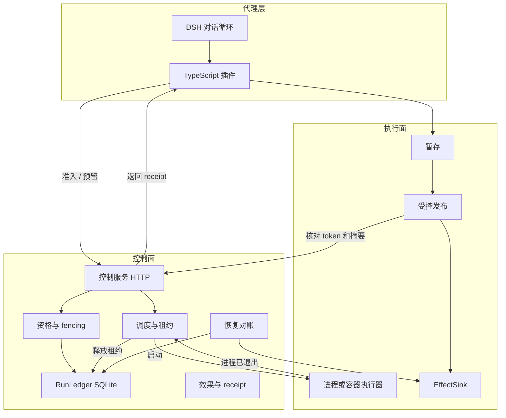
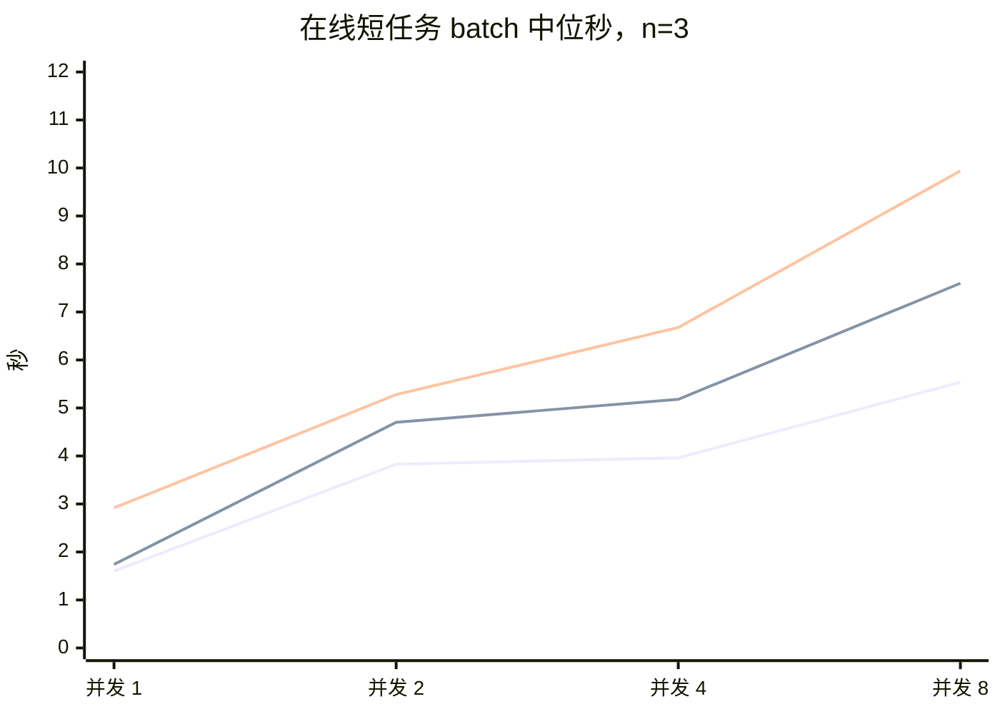

# EpochGate

**Reliable tool execution for LLM agents.**

State-aware execution eligibility, fenced side-effect commits, crash recovery, and cancellation for DeepSeek Harness agents.

Python 3.12 · SQLite · TypeScript · Docker · DeepSeek Harness

| 50 | 4 | 20 |
| --- | --- | --- |
| 控制面测试通过（2026-11-10，78.50 秒） | 崩溃检查点，退出码 86 | 每个提交臂的重复次数 |

离线命令不调用模型。下面是一次真实运行的终端输出：旧 token 被拒绝，新 token 写入并核对 receipt。

```text
Run                  demo-09573d69d47e
Attempt #1           REVOKED
Attempt #2           COMMITTED
Effect receipt       VERIFIED
Duplicate accepts    0
Execution control verified
```

```text
Run                  crash-352901face50
Worker exit          86
Recovery             confirmed_from_sink
Second recovery      replay
Effect receipt       VERIFIED
Duplicate accepts    0
Recovery verified
```

报告写在 `.epochgate/runs/<run-id>/report.html`。

## 为什么需要 EpochGate

工具按拿到资格时的世界执行。之后状态会变，进程可能还活着，文件或外部系统也可能已经写过。

| | 直接执行 | EpochGate |
| --- | --- | --- |
| 谁能写 | 工具进程自己 | RunLedger 上的 fencing token |
| 同一次副作用再来 | 可能再写一遍 | 已完成的幂等键重放 receipt |
| 写到一半进程没了 | 调用方自己猜 | EffectSink 对账；对不上就停在 `OUTCOME_UNKNOWN` |
| 取消 | 常常只是客户端断流 | 资格、停止信号、进程退出、槽位释放分开记录 |


旧 token 被拒绝，要先有一次可信的 `supersede` 或等价的状态重验。没有通知时，旧 token 仍会发布。新 token 能提交，还要求 Run 版本和 EffectSink 的提交前提一致。只推进 Run、不推进 sink 时，新 token 也会被拒绝。规则在 [协议](docs/现行/论文/协议.md)。

## 快速开始

在仓库里：

```powershell
uv run egctl doctor
uv run egctl demo --scenario stale-write --offline
uv run egctl demo --scenario crash-recovery --offline
uv run egctl runs list
uv run egctl runs inspect <run-id>
```

`<run-id>` 用 `runs list` 打出来的那一列。`runs inspect` 会打印时间线，并写出 `report.json` 和 `report.html`。`effects verify <run-id>` 核对 receipt。每次 Demo 使用新的 Run ID，不用删 SQLite。

只装控制面：`uv tool install ./packages/runtime`，然后直接用 `egctl`。

接 DSH 时开两个终端。第一个：

```powershell
uv run egctl serve
```

它打印 `http://127.0.0.1:8765`。第二个：

```powershell
$env:EG_CONTROL_URL = "http://127.0.0.1:8765"
$env:EG_REQUIRE_CONTROL = "1"

uv run egctl demo --scenario coding --model deepseek-flash
```

没有密钥时第二条会停下来，不会发请求。插件说明在 [接入](docs/现行/使用/接入.md)。

```python
from epochgate_runtime import Runtime

runtime = Runtime.open(".epochgate/epochgate.db")
attempt = runtime.reserve(
    run_id="example-001",
    resource="workspace/main.py",
)
runtime.close()
```

`reserve` 只申请资格。文件仍由控制面核对 token 和 SHA-256。

## 架构



提交从插件进入 Control Service，Publisher 核对 token 和摘要后把 receipt 交回插件。取消从 Scheduler 的 Lease 出发，进程退出之后才释放槽位。DSH 管对话。插件通过 HTTP 读回资格，自己不建第二本账。`eg_read` 只准入。写和命令才占资格。`eg-policy` 能提前拒绝 `.env`、gold 和 `git push`，不能授权发布。Publisher 先把暂存字节读进内存，再以 uid 1001 写入 `/workspace`。工具用户 uid 1000 只能写 `/scratch`。

SQLite 的 `BEGIN IMMEDIATE` 把资格检查串行化。它不包含文件系统。文件发布在事务里核对 token 和摘要，跨过数据库和磁盘的崩溃窗口靠受控发布和恢复对账补上同一次 claim，或者停在 `OUTCOME_UNKNOWN`。

| 层 | 选择 |
| --- | --- |
| Agent | DSH 0.2.2-rc.1。复用官方 Loop |
| 权威 | Python 3.12 + SQLite RunLedger |
| 插件 | TypeScript，只走本地 HTTP |
| 隔离 | `python:3.10-slim`，`--network none`，`no-new-privileges`，256MB，不挂载 docker socket |

单机账本。说明见 [运行时](docs/现行/架构/运行时.md)。

## 工程难点

| 问题 | 做法 | 已经看到的结果 |
| --- | --- | --- |
| 过期工具提交 | fencing token，SQLite 事务，受控 Publisher | 离线 Demo：Attempt #1 `REVOKED`，Attempt #2 `COMMITTED`，重复接受 0。DSH 会话里，没有通知时写下 `order 3`；对齐通知后旧 token 被拒，新 token 写下 `order 0` |
| 效果落地后崩溃 | 幂等键、receipt、EffectSink 对账 | 四个检查点各 3 次，退出码 86，接受次数 0、0、1、1。离线 Demo 的恢复是 `confirmed_from_sink`，再读一次是 `replay` |
| 取消不等于完成 | 资格、进程退出、槽位释放分开 | 8 次短进程都退出并释放槽位，0.712–1.084 秒。孙进程还活着时槽位不释放 |

入口：[副作用](docs/现行/协议/副作用.md)、[恢复](docs/现行/协议/恢复.md)、[取消](docs/现行/协议/取消.md)。离线命令就是上面的 `stale-write` 和 `crash-recovery`。

## 测量

两张图都来自 `deepseek-flash`。原始中位和文件路径在 [在线对照](docs/现行/基准/在线对照.md)。

在线短任务的 batch 中位秒。三条线依次是 B0 无账本、B1 只做资格、B2 写出 receipt。每格 n=3，三臂完成的控制路径不同，这张图是初步墙钟。



同等一次模型调用、同等一次 `OK` 提交。每臂 20 次，并发 1，全部完成。第一组柱是总时间中位，第二组是提交段中位。两组分开计算，不能把两个中位数相减当成同一次运行的分段。

```mermaid
xychart-beta
    title "单次提交中位秒，每臂 20 次"
    x-axis [B0, B1, B2]
    y-axis "秒" 0 --> 1.2
    bar [0.878, 1.034, 1.067]
    bar [0.096, 0.283, 0.283]
```



这一次短调用上，B2 的总时间中位比 B0 高约 21.5%。多出来的时间主要出现在提交段的中位上。

## 限制

资格不会自己看见外部文件或库存。通知没有到达时，旧 token 可以发布。文件发布核对的是 fencing token 和摘要，SQLite 与文件系统之间留有崩溃窗口，由恢复对账处理。`astropy__astropy-12907` 的两个官方节点能分开基线和 gold patch，没有 Agent 补丁。

## 文档

| | |
| --- | --- |
| 使用 | [快速开始](docs/现行/使用/快速开始.md)、[接入](docs/现行/使用/接入.md) |
| 架构与协议 | [运行时](docs/现行/架构/运行时.md)、[副作用](docs/现行/协议/副作用.md)、[恢复](docs/现行/协议/恢复.md) |
| 数字 | [在线对照](docs/现行/基准/在线对照.md)、[复现](docs/现行/复现/运行时.md) |
| CI | [ci.yml](.github/workflows/ci.yml)。`runtime` 在 Ubuntu 上跑控制面测试和离线 Demo。`containers` 在该 runner 的 Docker 上跑 Publisher 和容器测试。本机 2026-11-10 用 WSL `eg-alpine` 跑过同一组，9 passed，45.49 秒，记录在 [容器测试](docs/现行/复现/容器测试.md) |
| 实证测量 | [论文材料](docs/现行/论文/README.md) |
| 其余文档 | [索引](docs/README.md) |
