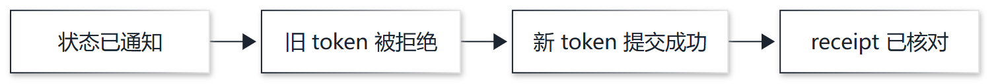
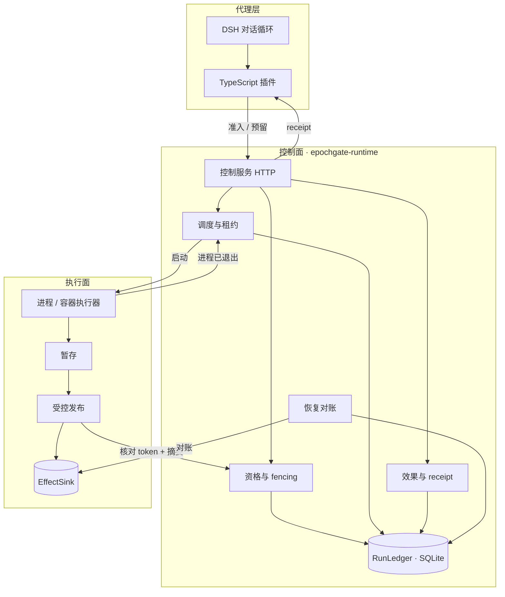
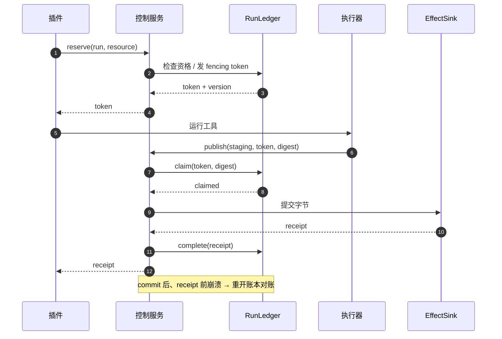
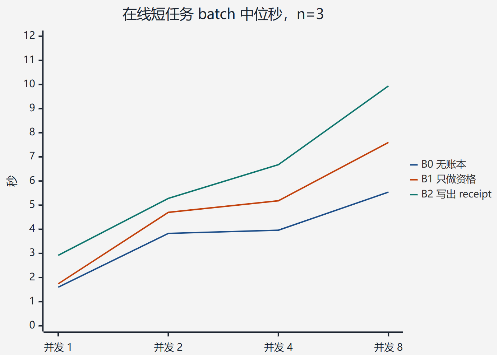
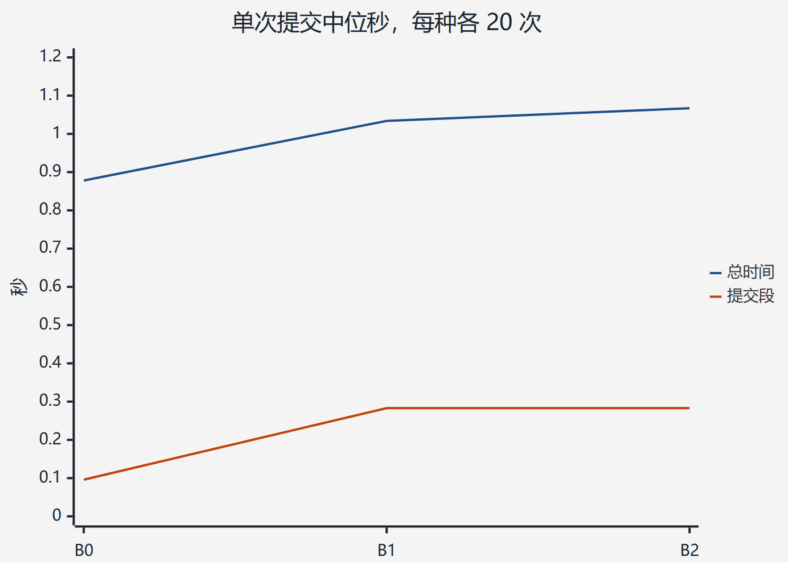

# EpochGate

**给 LLM Agent 的工具执行加一层可对账的控制面。**

单机 Python + SQLite。执行资格用 fencing token，副作用用幂等键和 receipt，崩溃后用 EffectSink 对账恢复。离线可跑，不需要 API key。

`Python 3.12` · `SQLite` · `TypeScript` · `Docker` · `DeepSeek Harness`

> **English:** A single-node control plane for reliable tool execution in LLM agents — fencing tokens for eligibility, idempotent effects with receipts, and crash recovery by sink reconciliation. Offline demos, no API key required.

## 技术栈

| 层 | 选型 | 作用 |
| --- | --- | --- |
| 语言 | Python 3.12 | 控制面、账本、恢复、实验脚本 |
| 存储 | SQLite，`BEGIN IMMEDIATE` 事务 | `RunLedger` 与 `EffectSink`，单机权威 |
| 控制服务 | Python 标准库 `ThreadingHTTPServer` | 本地 HTTP，无 Web 框架依赖 |
| Agent 集成 | DSH 0.2.2-rc.1 + TypeScript 插件（`eg-workspace` / `eg-policy` / `eg-observability`） | 对话循环、工具调用、准入 |
| CLI | Typer（`egctl`） | `doctor` / `demo` / `runs` / `effects` |
| 执行隔离 | Docker `python:3.10-slim`、`--network none`、`no-new-privileges`、256MB | 工具进程 |
| 测试 | pytest + hypothesis | 控制面不变量与负例 |
| 打包 | uv workspace + hatchling | `epochgate` 与 `epochgate-runtime` 两个包 |

## 60 秒演示

```powershell
uv run egctl doctor
uv run egctl demo --scenario stale-write --offline
uv run egctl demo --scenario crash-recovery --offline
uv run egctl runs list
```

真实输出：

```text
Run                  demo-09573d69d47e
Attempt #1           REVOKED
Attempt #2           COMMITTED
Effect receipt       VERIFIED
Duplicate accepts    0
Execution control verified
```

```text
Run                  crash-352901face50
Worker exit          86
Recovery             confirmed_from_sink
Second recovery      replay
Effect receipt       VERIFIED
Duplicate accepts    0
Recovery verified
```

报告写到 `.epochgate/runs/<run-id>/report.html`。

> 本机已装好环境时，也可以直接用 `.venv\Scripts\egctl.exe`（Windows）。

## 它解决什么问题

工具按拿到资格时的世界执行。之后状态会变，进程可能还活着，文件或外部系统也可能已经写过。

| 情形 | 直接执行 | EpochGate |
| --- | --- | --- |
| 谁能写 | 工具进程自己 | RunLedger 上的 fencing token |
| 同一次副作用再来 | 可能再写一遍 | 已完成的幂等键重放 receipt |
| 写到一半进程没了 | 调用方自己猜 | EffectSink 对账；对不上就停在 `OUTCOME_UNKNOWN` |
| 取消 | 常常只是客户端断流 | 资格、停止信号、进程退出、槽位释放分开记录 |



关键边界：**没有可信通知时，旧 token 仍会发布。** 受测保证是“相关状态变化已经进入控制面的资格状态之后，过期凭证可以被拒绝、合法后继可以完成”，不是“有 fencing token 就挡住一切过期效果”。

## 三个可复核的结果

| 问题 | 做法 | 结果 |
| --- | --- | --- |
| 过期工具提交 | fencing token + SQLite 事务 + 受控 Publisher | 离线 Demo：Attempt #1 `REVOKED`，Attempt #2 `COMMITTED`，重复接受 0 |
| 效果落地后崩溃 | 幂等键、receipt、EffectSink 对账 | 四个检查点各 3 次，退出码 86，接受次数 0、0、1、1；恢复 `confirmed_from_sink`，再读一次是 `replay` |
| 取消不等于完成 | 资格、进程退出、槽位释放分开 | 8 次短进程都退出并释放槽位，0.712–1.084 秒；孙进程还活着时槽位不释放 |

控制面测试：`pytest -q` → **203 passed**；1 项多进程用例在本机 Windows 沙箱下因命名管道权限失败（`WinError 5`），不是代码问题。CI 在 [ci.yml](.github/workflows/ci.yml)。

## 架构



提交从插件进入控制服务，Publisher 核对 token 和摘要后把 receipt 交回插件。取消从 Scheduler 的 Lease 出发，进程退出之后才释放槽位。插件通过 HTTP 读回资格，自己不建第二本账。SQLite 的 `BEGIN IMMEDIATE` 把资格检查串行化，但不包含文件系统；文件发布在事务里核对 token 和摘要，跨数据库和磁盘的崩溃窗口靠受控发布和恢复对账补上同一次 claim，或者停在 `OUTCOME_UNKNOWN`。

详细版（含租约与恢复路径）：[architecture.png](docs/assets/architecture.png)。

## 一次提交的生命周期



四步：**reserve → claim → commit → reconcile**。崩溃落在 commit 与 receipt 之间时，重开账本对账；确认不了就停在 `OUTCOME_UNKNOWN`，不猜。

## 开销





三条线是 B0 无账本、B1 只做资格、B2 写出 receipt。同等一次模型调用、同等一次 `OK` 提交，每种 20 次，并发 1，全部完成。B2 的总时间中位比 B0 高约 21.5%，多出来的时间主要在提交段。这是单机短调用的一次测量，不外推到集群。

## 仓库地图

| 目录 | 内容 |
| --- | --- |
| [`src/epochgate/`](src/epochgate/) | 研究运行时：B0/B1/B2 三臂、CLI、库存环境 |
| [`packages/runtime/`](packages/runtime/) | 控制面 `epochgate-runtime`：账本、Publisher、恢复、调度 |
| [`experiments/`](experiments/README.md) | 五个研究阶段 + 提交历史、配置选择、Git、包撤回、恢复义务 |
| [`results/`](results/README.md) | 可复核的汇总结果；原始运行目录不入库 |
| [`docs/`](docs/README.md) | 协议、架构、复现步骤、论文材料 |
| [`examples/`](examples/) | 四个可直接读的例子 |
| [`archive/`](archive/README.md) | 历史代码与调试轨迹 |

## 复现

```powershell
.venv/Scripts/python.exe -m pytest -q
.venv/Scripts/python.exe -m pytest experiments/historical_audit/reconstruction/tests -q
```

实验协议、逐格证据和复现命令见 [实验与证据](docs/实验/README.md) 与 [分阶段实验复现](experiments/README.md)。

## 限制

资格不会自己看见外部文件或库存；通知没有到达时旧 token 可以发布。文件发布核对的是 fencing token 和摘要，SQLite 与文件系统之间留有崩溃窗口。单机账本，不声称跨库原子性，也不声称任意 HTTP 服务的 exactly-once。

## 求职材料

- [PORTFOLIO.md](PORTFOLIO.md)：30 秒介绍、3 分钟 demo、设计取舍与面试问答。
- 研究线（终态评分盲区、配置选择、Git 效果归属、包撤回）见 [`experiments/`](experiments/README.md)；负结果和停止条件都保留在报告里。
