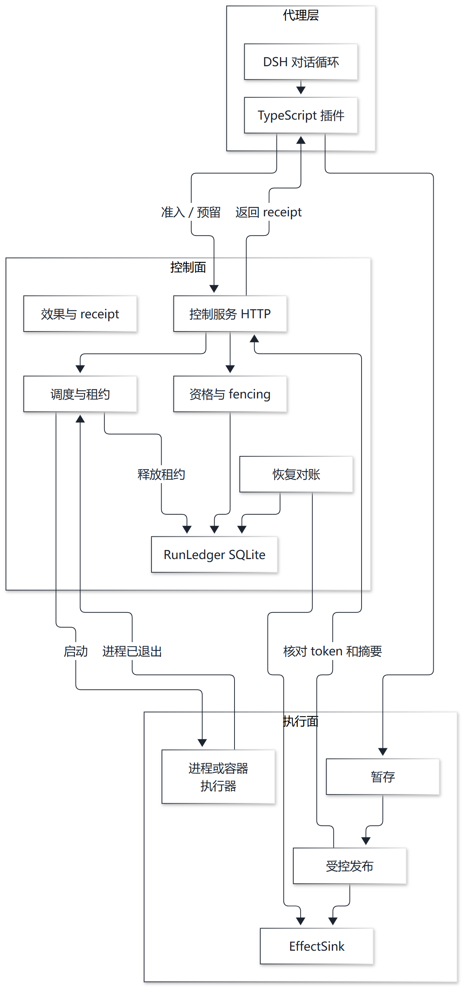
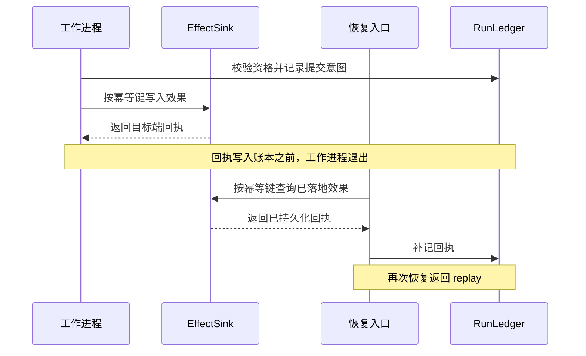

# EpochGate

**面向工具调用型 Agent 的单机可靠执行控制面与证据感知决策系统。** Agent 用状态、依赖和预算选择下一步，Runtime 用 Worker 租约、fencing token、目标端前置条件与回执控制效果提交。

*A single-node execution control plane for tool-using agents, with fenced commits, idempotent effects, and crash reconciliation.*

[快速演示](#快速演示) · [Agent 算法](#agent-算法) · [技术架构](#技术架构) · [实测对比](#实测对比) · [复现与源码](#复现与源码)

## 快速演示

需要 Python 3.12+ 和 [uv](https://docs.astral.sh/uv/)。两个离线演示均无需 API key 或 Docker。

```sh
uv run --locked --package epochgate-runtime egctl demo --scenario stale-write --offline
uv run --locked --package epochgate-runtime egctl demo --scenario crash-recovery --offline
```

| 场景 | 实际输出 | 可以核对的结果 |
| --- | --- | --- |
| 通知送达后，旧执行尝试写入 | `REVOKED` → `COMMITTED` | 旧尝试被拒，获得新资格的尝试成功提交 |
| 目标已写入，进程在回执持久化前中断 | 退出码 `86` → `confirmed_from_sink` → `replay` | 首次恢复从目标端补记回执，第二次返回已有结果 |

两个演示均验证回执，重复接受数为 **0**。终端输出 `report.json` 的位置，同目录的 `report.html` 可直接打开查看时间线。

### 浏览器工作台

首次体验可启动隔离演示。离线演示和实验归档复核无需模型密钥或 Docker。

```sh
uv run --locked --package epochgate-runtime egctl serve --demo-mode --port 8766
```

打开 [http://127.0.0.1:8766/](http://127.0.0.1:8766/)。演示数据保存在默认数据目录下的 `demo-mode` 子目录。

日常运行使用独立的本地控制面。

```sh
uv run --locked --package epochgate-runtime egctl serve
```

打开终端打印的地址，默认是 [http://127.0.0.1:8765/](http://127.0.0.1:8765/)。真实 Agent 任务需要可访问的 Docker Linux 引擎、DSH 和模型配置。运行工作台提供预检。

工作台支持 Run 对比、资格与回执追踪、27 格冻结实验的独立重算和证据导出。 [工作台说明与截图](docs/observatory.md)

**首页能打开但接口返回 HTTP 404**时，用当前地址的 `/health` 检查服务。新版返回 `authority: run_ledger` 和 `mode` 字段。如果首页加载的是新版界面，而健康响应缺少 `mode`，请停止旧服务，沿用原来的 `--config` 和 `--data-dir` 启动，再刷新浏览器。端口冲突时可用 `--port` 指定未占用的端口。

[7 分钟演示](docs/product/DEMO.md) · [架构](docs/product/Architecture.md) · [API](docs/product/API.md) · [部署](docs/product/DEPLOYMENT.md) · [发布验收](docs/product/RELEASE.md) · [Agent 可靠性核查](docs/agent/HARDENING.md)

### 启动 Evidence-Aware Agent

在两个终端分别启动 API 和 Worker，使用相同的数据目录。

```sh
uv run --locked --package epochgate-runtime egctl serve --port 8767 --data-dir .epochgate/decision-demo
uv run --locked --package epochgate-runtime python -m epochgate_runtime.durable_worker --data-dir .epochgate/decision-demo --receiver-url http://127.0.0.1:8767
```

打开工作台，在「提交 Agent 计划」粘贴下面的离线任务。配置 DeepSeek 后也可用 `prompt` 和 `resources` 生成计划。Run Details 可追踪决策、回执和预算，系统页显示排队、有效租约和待接管任务。

```json
{"plan":[{"step_id":"publish","effect":{"release-note":"candidate"}}],"budget":{"tools":5,"replans":2}}
```

## Agent 算法

| 模块 | 关键实现 | 可核查输出 |
| --- | --- | --- |
| 状态感知的局部修复 | 将计划表示成带读写集、业务前置条件和依赖的 DAG。检查发生变化的资源，沿依赖传播失效，修复未提交的后继并保留已提交历史。 | 变化资源、失效与保留节点、修复前后计划 |
| 证据感知恢复 | 根据资格、业务有效性、已知效果和接收端能力过滤动作。可查询的 `UNKNOWN` 优先取回执，核对任务、步骤、载荷和摘要。回执不匹配或目标不可用时保留未知。 | 候选动作、原因、目标回执与恢复结果 |
| 预算与成本 | 记录模型实际 Token 用量和工具、重规划预算。在合法候选内使用可解释的启发式成本排序。 | 动作成本估计、预算消耗与停止原因 |

决策模块提出动作。独立 Worker 领取 SQLite 持久任务，并由受控接收端在写入事务中校验活跃 epoch、已登记提案、资源版本和业务前置条件。重复提交按任务与步骤去重。模型任务可用 `Idempotency-Key` 安全查询已登记结果，避免因响应丢失重复调用模型。 [实现](packages/runtime/src/epochgate_runtime/agent_decision.py) · [持久队列](packages/runtime/src/epochgate_runtime/durable.py) · [故障验证](docs/agent/VERIFICATION.md)

## 技术架构



| 组件 | 职责 |
| --- | --- |
| [RunLedger](packages/runtime/src/epochgate_runtime/ledger.py) | 在 SQLite 持久化执行资格、提交状态和事件，提交时校验 token |
| [文件发布](packages/runtime/src/epochgate_runtime/files.py) · [EffectSink](packages/runtime/src/epochgate_runtime/sink.py) | 发布目标效果，通过幂等键、摘要和回执核对结果 |
| [恢复](packages/runtime/src/epochgate_runtime/recovery.py) | 查询受控接收端，确认已落地效果；证据不足时保留 `OUTCOME_UNKNOWN` |
| [调度](packages/runtime/src/epochgate_runtime/scheduler.py) | 记录执行槽位，等待进程退出后释放 |

### 写入后中断，如何恢复



提交资格依赖控制面收到状态变化。SQLite 事务覆盖账本操作，文件效果通过受控发布和恢复对账衔接。演示中的恢复行为依赖目标端实现可查询的幂等记录。

## 实测对比

### Agent 决策与真实编码

在 **40 个冻结离线任务、5 个策略**上，对比全量重规划、版本修复、强语义修复、局部修复和局部修复加证据恢复。局部修复与强语义基线均完成 **16/40**，重规划 **8 次**、工具请求 **96 次**，局部修复保留了 **8/28** 个未提交节点。加入证据恢复后完成 **32/40**，工具请求增至 **136 次**，`UNKNOWN` 从 **20** 降到 **4**。本轮没有观测到违规或重复效果。离线回放未调用模型，结论范围为这批夹具。

单次真实 Coding Agent 使用 DeepSeek Flash 读取 Issue 与代码、写入补丁、运行 Docker 测试，并在配置变化后修复局部计划。最终 **4 项测试通过**，记录 **21,257 Token、14 次工具请求、约 50 秒**。Docker 测试由 PowerShell 桥接；工作台通用 DSH 路径仍需 Python 进程可访问 Docker。 [评测、原始记录与复现](docs/agent/EVALUATION.md)

### 终态通过时，哪些检查发现了问题

受控实验覆盖 SQLite 和文件发布，共 **27 格**。每格终态都符合预期，其中 **4 格**曾落地业务无效效果，随后由合法后继修正。

| 判定依据 | 检出的业务无效效果格数 |
| --- | ---: |
| 终态 | 0 |
| 终态 + 授权、去重和回执 | 0 |
| 提交时的业务状态 | **4** |

这是同一矩阵上的检出对比。4／27 是构造场景中的计数，生产发生率未知。 [实验协议与复现](experiments/effect_history/README.md) · [逐格报告](results/experiments/effect-history/pilot-01/report.json)

### 同载荷提交的时间开销


| 配置 | 总时间中位数 | 提交段中位数 |
| --- | ---: | ---: |
| B0 · 仅检查接收端版本 | 0.878 s | 0.096 s |
| B1 · 通过控制面校验资格并提交 | 1.034 s | 0.283 s |
| B2 · B1 加重新打开账本读取回执 | 1.067 s | 0.283 s |

历史在线测量中，并发为 1，每臂 20 次，使用相同模型、任务和 `OK` 载荷，三臂均完成。B2 在这项短任务上的总时间中位数比 B0 高 **21.5%**。提交段和总时间分别取中位数。 [测量口径与原始结果入口](docs/现行/基准/在线对照.md)

## 复现与源码

```sh
uv run --locked pytest packages/runtime/tests -q
```

这条命令测试现行控制面。[CI](.github/workflows/ci.yml) 另跑容器集成和历史研究契约。

[运行时源码](packages/runtime/) · [完整架构](docs/现行/架构/仓库布局.md) · [实验复现索引](experiments/README.md) · [三分钟面试演示](PORTFOLIO.md)
