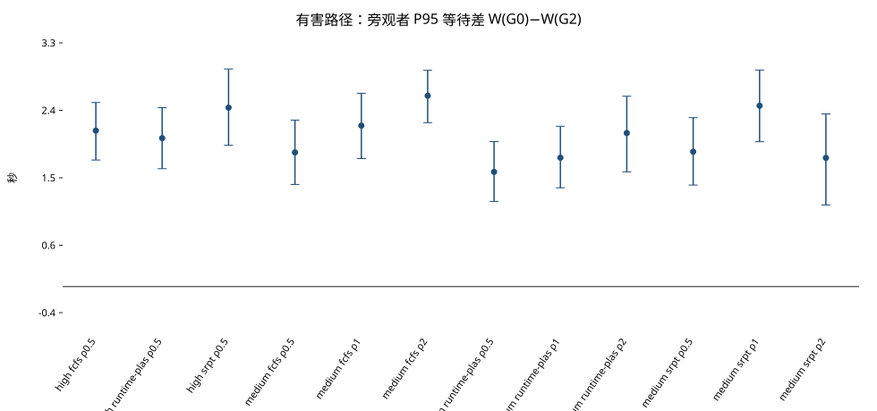
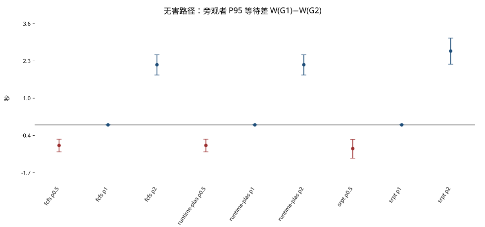
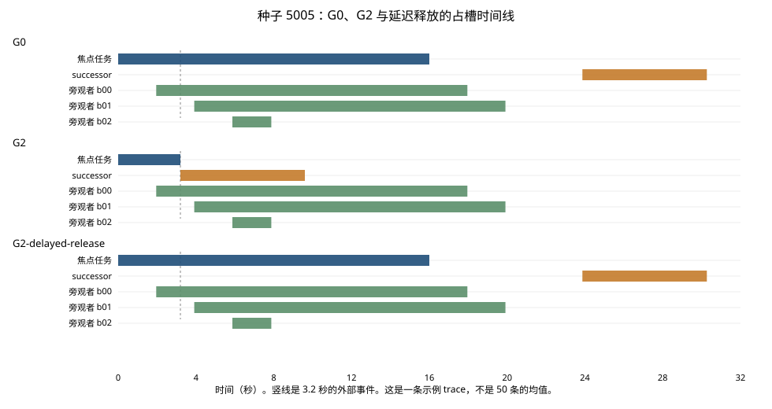

# Bystander Workflow Latency under State-Triggered Revocation in Shared Agent Runtimes

状态触发撤销下，共享 Agent Runtime 中旁观工作流的等待

测量题也可以写成：Measuring the Queue Externality of State-Triggered In-Flight Revocation in Agent Runtimes。这里的 queue externality 是被测量的对象。Vesta 已经用这个词给放置和 KV 传输定价，本文不把它当作新概念。

包版本 4.0.0。主数字来自 3.0.0 的逻辑时钟回放，协议哈希 `37f9846b2504b61c4e535940f9cc4df741fe9b462d6f99458b55a40ee2138213`。确认性 JSONL 没有重跑。P95 定义和服务量分解由 `scripts/audit_v40_p95.py` 从这 2400 行重算，写在 `results/experiments/v4_0/audit/v40_p95_and_service.json`。

这是一份受控槽模型上的测量初稿，不是新的 Runtime 算法，也不是一条脱离服务量差的队列定律。v1.2 的真实 API 证据在 [论文初稿.md](论文初稿.md)。

## 摘要

共享槽上，一个正在执行的 attempt 会因为外部状态失去前提，或者只是碰到相关信号。撤销政策改变这只槽在事件之后还要做多少工作。后继或 restart 会吃掉刚放出的容量。独立旁观者看到的是这条被改过的服务时间线。

本文比较三种处理。G0 把失效尾巴读完再拒绝。G1 见相关信号就停并重做。G2 只在前提为假时立刻放槽。在 4 个槽、早时机、中负载和高负载上，有害路径的 G2 相对 G0 少做 12.8 秒已经失效的占用，successor 长度相同，下一只槽 600/600 交给 successor。旁观者 P95 等待仍少 1.55–2.58 秒，12/12 格跨过预先冻结的门槛。无害路径上，差的符号跟着 restart 与剩余有效服务的长短走：短则误撤让旁观者少等，相等则差为 0，长则不误撤更好。完成率差为 0。没有排队时，等待差也是 0。

这些句子只描述这个逻辑时钟模型。它们不表示供应商已停止生成，也不表示 G2 在每一格都更好。

## 1. 贡献

现有工作分别研究过期计划保护、在途执行撤销、后继交接和 workflow 调度。本文测量它们在共享 Runtime 槽上的交互：状态触发的前提失效如何改变独立工作流面对的服务量，后继或 restart 如何占用刚放出的容量，以及旁观者等待如何随 restart 成本和调度策略变化。

三条贡献，都限于下面写明的回放：

1. **旁观者是主指标。** 评价对象是没有参与这次前提变化的工作流，不只是被撤销的任务或 successor 自己的 TTFT。
2. **撤销的队列效果取决于事件后的工作量。** 前提失效时，少做的是失效尾巴。前提仍成立时，误撤会注入 restart。restart 短于、等于或长于剩余有效服务，旁观者等待差分别为负、零、正。
3. **容量传递可以在事件时间线上读出来。** 有害 G2 的下一只槽交给 successor，旁观者仍然少等，因为少执行的是失效尾巴。只撤销、不放槽，等待和 G0 一样。队列消失时，收益消失。

不写的主张：新的调度算法，首次发现 queue externality，G2 是最优撤销策略，供应商取消后 GPU 或 KV 已回收，以及“现有工作完全没有看过无关工作流”。

## 2. 相关工作

核对日期 2026-11-04。所核验近邻中，没有一篇把旁观者 P95、前提是否成立、restart 比率和调度器放进同一个主矩阵。这只说明比较组合少见，不能自动推出问题重要、结论意外或方法新颖。差别在测量对象和对照，不在“别人没有看过旁边的任务”。

### 2.1 Retire：最近的撤销工作，而且已经检查过无关租户

Retire（Zhang 等，arXiv:2610.01160）把请求的资源所有权和执行版本的发布权分开。ADVANCE、FENCE、ALIGN、RESUME、RECLAIM 负责撤销旧执行、约束剩余工作、继承有效前缀和异步回收。实现在 vLLM 上。主指标包括 successor 的 TTFT（受控配对实验中位数降 17.1%）、当前版本 goodput（54.0 对原生 abort 的 9.77 tok/s）和清理。

它还做了租户共享。TP=4 的 co-tenant 实验里，替换 Tenant A 之后，三个种子上 Tenant B 的 KV digest 和 block ID 不变；Tenant B 的 median runtime 变化 1.0%，cross-interrupt frame gap 变化 1.8%。因此不能写“现有工作没有测量撤销对无关工作流的影响”。

| | Retire | 本文 |
| --- | --- | --- |
| 对象 | 版本化执行和 serving handoff | 状态触发的 Runtime 在途撤销 |
| 机制 | 版本权限、FENCE、状态继承、异步回收 | G0 / G1 / G2 对照 |
| successor | 优化恢复和 TTFT | 共享槽上的后继工作量 |
| 无关工作 | co-tenant 隔离和性能变化 | 独立 bystander 的等待是主指标 |
| 主指标 | successor TTFT、current-version goodput、清理 | bystander P95 等待、完成时间 |
| restart 成本 | 不是主变量 | \(\rho_b\) 是主变量 |
| 政策 × restart × 调度器 | 不是核心矩阵 | 是核心矩阵 |

可以写的差别：Retire 检查的是撤销有没有破坏无关租户的缓存和运行时间。本文把独立工作流的等待分布，以及它随 restart 成本的正、零、负变化，做成主实验。

### 2.2 Readiness/Release：最近的 workflow P95 调度

Decoupling Readiness from Release（arXiv:2609.10964）用 SWE-bench 和 SWE-Gym 的执行轨迹，取 100 个 workflow，在不同到达率下配对回放，主报 workflow 的 P95 端到端 flow time。它解耦的是“已经 ready”和“何时把下一轮放进 serving”。争用下 P95 最多缩短 3.50 倍。

它说明 workflow P95 已经是系统论文里的指标。本文不能靠“第一次测量 Agent workflow 的 P95”建立创新性。它没有回答：一个正在占槽、前提已经变了的 attempt，应不应该撤销。两边的控制变量不同。它管 release budget 和回合顺序。本文管前提是否仍成立、失效尾巴、successor 或 restart 的服务量，以及调度器。

### 2.3 其余相邻工作

| 工作 | 它已经做了什么 | 本文不重复的部分 |
| --- | --- | --- |
| Vesta，arXiv:2610.14686 | 用 queueing externality 决定请求放在哪台机器。共置部署吞吐 +14.0%，平均 TTFT −57.8% | 槽数已经固定时，撤销如何改同一条队列 |
| Agentix，NSDI 2026；早期版本 Autellix，arXiv:2502.13965 | PLAS / ATLAS 按程序已完成服务调度。程序吞吐相对 vLLM 提高 4–15 倍。两篇算同一条工作 | Runtime-PLAS 只借用排序，是 fixed-slot 回放里的基线 |
| PlanFence，arXiv:2609.03340v2 | *Fresh Memory, Stale Plans: Derivation Currency for Distributed LLM-Agent Memory*。动作提交前检查依赖是否仍有效。它的 \(\rho\) 是更新强度 | G0 只是动作边界拒绝的基线，不是 PlanFence 的复现。前提检测本身也不是本文提出的 |
| Stop Means Stop，arXiv:2607.14166 | 六个框架的暂停和取消没有屏障语义 | 本文假定本地停读已经发生，再测队列。API 事件链不是新的取消理论 |
| BRACE，arXiv:2608.01428 | 具身智能体重规划 token 减少 62–92% | restart 的服务长度如何占共享槽 |
| Root-Scoped Quiescence，arXiv:2609.21284 | 授权根撤销后的静默证书，17/17 条轨迹符合 | 不发证书，只测等待 |
| Lee、Pedarsani、Ramchandran，IEEE/ACM Trans. Netw.，DOI 10.1109/TNET.2016.2622248 | 取消开销会改变冗余请求的最优调度 | “取消会影响排队”本身不是新发现 |
| Ramakrishna、Peng、Scully，arXiv:2605.01522 | 带暂停和恢复开销的 M/G/1 抢占优先级，给出响应时间变换 | 抢占及其成本已有队列理论。本文不声称发现了这条理论之外的定律 |

## 3. 定义

一次 trace 一个焦点事件。旁观者是主指标的唯一对象。

| 角色 | 是什么 |
| --- | --- |
| target | 前提会被破坏的在途尝试 |
| false target | 依赖同一来源，前提仍成立。G1 会误撤它 |
| successor | 有害事件后，同一工作流必须做的后继 |
| restart | 无害误撤后的重做 |
| bystander | 与这次事件无关的工作流 |

| 政策 | 事件之后这只槽还做什么 |
| --- | --- |
| G0 | 把剩余服务做完，提交时拒绝，然后才放 successor |
| G1 | 相关信号一到就放槽，并放入 successor 或 restart |
| G2 | 只有前提为假才立刻放槽。前提仍成立则把剩余有效服务做完 |
| G2-delayed-release | 有害时拒绝提交，但槽占到原服务结束。只作机制对照 |

\(\rho_h\) 是 successor 长度除以失效时的剩余服务。\(\rho_b\) 是 restart 长度除以仍然有效的剩余服务。主格取 0.5、1、2。早时机剩余服务是 12.8 秒，所以 restart 长度是 6.4、12.8、25.6 秒。

等待是第一次拿到槽减去到达。\(\Delta W = W(\mathrm{baseline})-W(\mathrm{G2})\)，正数表示 G2 更短。有害基线是 G0，无害基线是 G1。

## 4. 设计

离散事件，逻辑时钟，不用模型估计 P95。焦点任务 16 秒，在 0 时刻到达。早时机事件在 3.2 秒。旁观者 36 个，服务短/中/长为 2/6/16 秒，混合比例 40/20/40（与 `workload.py` 中 short/mid/long 权重一致）。到达在开跑前哈希。同一种子只改政策。1050 个主对照配对的到达哈希差为 0。

回放里的 G2 使用工作负载上的有害/无害标签直接分支，前提检查时间为零。这是**理想化的语义判定与即时本地释放**条件，比较的是已知类别下的政策后果，不是普适语义失效检测器的实现证明。

4 个槽。中负载到达间隔 1.9573 秒，高负载 1.7824 秒，由 FCFS+G0 的等待中位数标定，分别是 2.747 秒和 5.338 秒。FCFS 把后继放进队尾。名为 SRPT 的臂在实现上是**已知服务量的非抢占排序准入，并叠加 25 秒 aging**：只在存在空槽时按剩余服务量从等待队列选任务，新短任务到达不会抢占正在运行的任务。它是 clairvoyant oracle，不表示真实 Runtime 知道还要跑多久，也不能等同标准抢占式 SRPT。Runtime-PLAS 按同一工作流已完成服务排序，完成越多越靠后，老化 25 秒。它是 Agentix-PLAS 的排序规则在固定槽回放里的基线，不是那套 serving 系统的复现。

每格 50 条 trace，种子 5000–5049。Pilot 的 1000–1014 不进主表。Bootstrap 以配对后的 trace 差为单位，10000 次，种子 20261103。

门槛在开跑前冻结，两条同时成立才算跨过：

1. 点估计相对基线至少 10%。
2. 绝对差的 2.5% 分位大于 0。

这不是“区间证明至少改善 10%”。完成率下降超过 2 个百分点算伤害。操作检验先于队列解释：有害时 G1 与 G2 的放槽时刻在 150 个配对上一致；无害 G2 误撤为 0，G1 每条都有 restart；旧提交和重复副作用为 0。

## 5. P95 是什么

每个 trace 先算 36 个旁观者的等待，再做线性插值。秩是 \((n-1)\times 0.95 = 33.25\)，所以 \(W_{95}\) 是第 34 和第 35 个顺序统计量的 0.75/0.25 加权。格子上的估计是 50 个同种子配对差的平均。Bootstrap 重采样的是这 50 个差，不是把两臂拆开，也不是把 \(50\times 36\) 个旁观者当成独立样本。同一条 trace 里的旁观者共享一条队列。

代码里有一条封顶规则：到观察窗结束还没拿到槽，等待记成窗长。那是 capped wait。若直接把它当成真实等待，尾部会被压低。确认性 2400 行上这条规则没有发生：`censored_wait_count` 全是 0，旁观者完成率全是 1.0，\(W_{95}\) 最大 31.76 秒，观察窗最短 128.17 秒，没有任何一行的 \(W_{95}\) 顶到窗长。因此主表里的 P95 是观察窗内的精确首次拿到槽时间，不是封顶指标，也没有右删失样本需要用生存曲线来补。

这只说明这份冻结表没有删失。以后如果有旁观者在窗内没启动，那些行必须单独标成 capped wait，不能再叫无条件 P95。

## 6. 主结果

图由 `scripts/plot_v21_figures.py` 从 `results/experiments/v2_1/reports/v21_summary.json` 画出。



### 6.1 有害：前提已经为假

\(\Delta W_{95}=W(\mathrm{G0})-W(\mathrm{G2})\)。12/12 跨过门槛。三种调度器方向一致。没有做等效性检验，不能写“调度不影响幅度”。同一份 12.8 秒失效尾巴，P95 少掉的秒数从 1.55 到 2.58，这部分幅度差来自排序，见第 7 节。

| 负载 | 调度 | \(\rho_h\) | 基线（秒） | 差（秒） | 区间 | 相对 |
| --- | --- | ---: | ---: | ---: | --- | ---: |
| 高 | fcfs | 0.5 | 15.377 | 2.110 | [1.712, 2.490] | 0.137 |
| 高 | runtime-plas | 0.5 | 15.276 | 2.009 | [1.595, 2.421] | 0.132 |
| 高 | srpt | 0.5 | 15.987 | 2.421 | [1.912, 2.944] | 0.151 |
| 中 | fcfs | 0.5 | 11.796 | 1.815 | [1.382, 2.252] | 0.154 |
| 中 | fcfs | 1 | 12.893 | 2.177 | [1.731, 2.616] | 0.169 |
| 中 | fcfs | 2 | 15.451 | 2.581 | [2.218, 2.926] | 0.167 |
| 中 | runtime-plas | 0.5 | 11.533 | 1.552 | [1.153, 1.961] | 0.135 |
| 中 | runtime-plas | 1 | 12.459 | 1.743 | [1.337, 2.170] | 0.140 |
| 中 | runtime-plas | 2 | 14.947 | 2.078 | [1.552, 2.575] | 0.139 |
| 中 | srpt | 0.5 | 12.157 | 1.825 | [1.373, 2.286] | 0.150 |
| 中 | srpt | 1 | 13.626 | 2.447 | [1.960, 2.929] | 0.180 |
| 中 | srpt | 2 | 15.563 | 1.741 | [1.104, 2.336] | 0.112 |

不是每条 trace 都改善。中负载 FCFS、\(\rho_h=0.5\) 有 10/50 条差为 0。中负载 SRPT、\(\rho_h=2\) 有 9/50 条为负。去掉任意一条种子后，12 格均值仍为正，相对改善仍不低于 0.107。

完成时间同号变短，相对幅度约 0.058 到 0.100，没有一格跨过 10%。完成率两侧都是 1.0。

### 6.2 无害：前提仍然成立



| 调度 | \(\rho_b\) | 基线（秒） | 差（秒） | 区间 | 相对 | 门槛 |
| --- | ---: | ---: | ---: | --- | ---: | --- |
| fcfs | 0.5 | 9.981 | −0.735 | [−0.965, −0.513] | −0.074 | 否 |
| fcfs | 1 | 10.716 | 0 | [0, 0] | 0 | 否 |
| fcfs | 2 | 12.870 | 2.154 | [1.787, 2.511] | 0.167 | 是 |
| runtime-plas | 0.5 | 9.981 | −0.735 | [−0.965, −0.513] | −0.074 | 否 |
| runtime-plas | 1 | 10.716 | 0 | [0, 0] | 0 | 否 |
| runtime-plas | 2 | 12.870 | 2.154 | [1.787, 2.511] | 0.167 | 是 |
| srpt | 0.5 | 10.332 | −0.847 | [−1.195, −0.522] | −0.082 | 否 |
| srpt | 1 | 11.179 | 0 | [0, 0] | 0 | 否 |
| srpt | 2 | 13.822 | 2.642 | [2.172, 3.107] | 0.191 | 是 |

FCFS 在 \(\rho_b=0.5\) 是 32 负、18 零、0 正；\(\rho_b=1\) 是 50 条全 0；\(\rho_b=2\) 是 48 正、2 零。SRPT 在 0.5 有 2 条为正，均值仍为负，留一之后不跨过 0。FCFS 与 Runtime-PLAS 数字相同，因为无害路径上排序没有改派发。完成率仍是 1.0。无害 G1 的 restart 是 450 次，每条一次；G2 是 0。

精确为 0 只属于早时机、两边事件后工作量相等的格子。中时机、\(\rho_b=1\) 时，FCFS 均值 −0.049 秒且区间跨过 0；Runtime-PLAS −0.364 秒，SRPT −0.302 秒。这 30 条不进主表。

## 7. 服务量如何传到等待

有害路径上，G0 在 16.0 秒放槽，G2 在 3.2 秒放槽，600/600 个配对都少占 12.8 秒。两边的 successor 服务差最大为 0。G2 记下的回收量是 12.8 秒。下一只槽全是 successor。

所以 G2 少做的不是 successor，也不是把槽留给旁观者。少做的是前提已经为假的那一段。旁观者 P95 少掉的 1.55–2.58 秒，相当于这 12.8 秒里每一秒传到 P95 上 0.121–0.202 秒。系数不到 1，也不是简单的 \(1/4\) 槽。同一份少掉的服务，SRPT、FCFS、Runtime-PLAS 给出不同幅度。符号由少掉的服务决定，幅度里还有排序。

无害路径上，G2 把剩余的 12.8 秒有效服务做完，restart 为 0，下一只槽是 bystander。G1 在 3.2 秒放槽，restart 等于 \(\rho_b\times 12.8\)，下一只槽是 restart。G2 相对 G1 的事件后工作优势是 restart 减去 12.8 秒。

| \(\rho_b\) | G1 的 restart | G2 多做或少做 | FCFS 的 \(\Delta W_{95}\) | 符号是否一致 |
| ---: | ---: | --- | ---: | --- |
| 0.5 | 6.4 秒 | G2 多做 6.4 秒 | −0.735 秒 | 是。误撤的总工作更短，旁观者少等 |
| 1 | 12.8 秒 | 事件后工作相同 | 0 | 是 |
| 2 | 25.6 秒 | G2 少做 12.8 秒 | +2.154 秒 | 是。不误撤的总工作更短 |

非零无害格上，每一秒工作优势对应的 P95 变化是 0.115–0.206 秒。21 个主格的符号都与事件后工作差的符号一致。

这支持一个收窄后的说法：在这个模型里，选择性撤销并不是无条件地改善所有工作流。误撤的队列代价取决于重新执行的工作量。它不支持“本文发现了服务量守恒之外的新定律”。方向是工作量差的方向。测量给出的是传导系数、下一只槽是谁，以及相等工作量在早时机上可以精确抵消。



种子 5005、FCFS、\(\rho_h=0.5\)：G2 在 3.2 秒放槽，P95 为 6.374 秒。G0 和延迟释放都在 16.0 秒放槽，P95 都是 11.163 秒。20 条边界格上，延迟释放和 G0 的均值都是 14.233 秒。这 20 条不与 50 条主格同等强度。只撤销、不立刻放槽，等待没有离开 G0。种子 5000 上三臂 P95 同为 2.235 秒，所以单条 trace 可以没有差距。没有做中介分析。延迟释放还不能写成“失效尾巴是唯一通道”。

Runtime-PLAS 相对 FCFS：无害路径 7399 次可比较派发，顺序不同 0 次。有害 G2 上也没有不同。差异出现在有害 G0，大约四分之一的决策，因为失效任务一直占槽，已完成服务才在旁观者之间拉开。有害格子里两种调度的幅度差来自 G0 基线。无害格子里数字相同，是因为排序没有变，不是第二次独立复现。

低负载到达间隔 20 秒时，等待中位数是 0，\(\Delta W_{95}\) 也是 0。没有排队，少做的服务没有旁观者可以传给。

## 8. 边界实验

每格 30 条，种子 12000–12029，不进主表。到达间隔不重新标定。服务长度仍然来自协议，不是从公开 Agent trace 抽出来的。

| 扰动 | 有害方向 | 无害 0.5 / 1 / 2 | 和主门槛的关系 |
| --- | --- | --- | --- |
| 服务时间或到达 ±25%，三种长度混合 | 仍为正，FCFS 相对约 0.11–0.15 | 负 / 零 / 正 | 早时机的模式还在 |
| 2 个槽 | 绝对差约 6–12 秒，区间下界大于 0 | 同样反转 | 相对幅度常低于 10%，因为基线本身很大 |
| 8 个槽 | 绝对差约 0.01 秒，区间含 0 | \(\rho_b=0.5\) 的差变成 0 | 基线接近 0。相对值接近 1 不能解释成 100% 改善 |
| 中时机 | FCFS 相对约 0.08–0.10，方向为正 | \(\rho_b=1\) 不再精确为 0 | 不升格进主句 |

这些扰动说明结果不是某一个 2/6/16 秒混合的单点。它们不能代替第二套来自公开执行轨迹的服务时间。Readiness/Release 使用 SWE-bench 和 SWE-Gym 的回合与工具时间。本文还没有把那样的轨迹放进 G0/G1/G2。在那套工作负载做出来之前，本文的外部有效性停在这个槽模型。

真实 API 60 条，种子 9100–9109，`max_inflight=2`，传输错误 0。旧提交 0。无害误撤是 G1 的 10/10、G2 的 0/10。有害 G2 的撤销、本地停读、放槽都出现；9/10 的顺序是撤销、停读、放槽，种子 9104 的放槽早 0.015 秒。两个任务同时在飞，第二个不是排队旁观者。没有调用供应商取消接口。这 60 条不与回放秒数相加，也不构成新的取消正确性理论。

## 9. 限制

服务时间和 \(\rho\) 由协议设定。符号与事件后工作差一致，说明方向可以用少做或多做的服务来解释。有害路径上，总 P95 等待差是 1.55–2.58 秒；相对少做的 12.8 秒失效占用，每减少 1 秒客户端占用对应约 0.12–0.21 秒的 P95 传导比。下一只槽是 successor 时旁观者仍然少等，是这份回放量到的传导，不是所有 Runtime 的最优阈值。

名为 SRPT 的臂使用已知剩余时间做非抢占准入。Runtime-PLAS 不是新算法。8 个槽或低负载下收益消失。完成率在排水窗口内都是 1。v1.8 的 980 行没有角色字段。客户端停读不是 GPU 或 KV 已回收。Retire 已经用三个种子检查过无关租户的 KV 和运行时间。本文没有复现那个 GPU 实验。

## 10. 结论

在 4 个槽、冻结到达率和早时机下，前提失败后立刻放槽，少做 12.8 秒失效占用。successor 长度不变，下一只槽交给 successor，旁观者 P95 仍然变短，12/12 个有害主格跨过门槛。三种调度器的方向一致，幅度不同。前提仍成立时，restart 更短则误撤让旁观者少等，工作量相等则早时机上的差为 0，restart 更长则不误撤更好。没有排队时，等待差消失。完成率没有差。

主表上的 P95 是精确的首次拿到槽时间。封顶规则在这 2400 行里没有被用到。

## 参考文献

核对日期均为 2026-11-04。未逐篇核对作者页的条目只列标题和标识。

1. Yanxin Zhang, Rahul Sharma, Nitin Vegesna, Zheyu Fu, Chang Liu, Trivikram Krishnamurthy. Serving a Revisable World: Versioned Execution for Interruptible Agents. arXiv:2610.01160.
2. Decoupling Readiness from Release for Tail-Aware Scheduling of Agentic LLM Workflows. arXiv:2609.10964.
3. Vesta: Queueing-Aware LLM Scheduling for Real-World Workloads. arXiv:2610.14686.
4. Agentix: An Efficient Serving Engine for LLM Agents as General Programs. NSDI 2026. 早期版本：Autellix, arXiv:2502.13965.
5. Evan Chen, Shiqiang Wang, Christopher G. Brinton. Fresh Memory, Stale Plans: Derivation Currency for Distributed LLM-Agent Memory. arXiv:2609.03340v2.
6. Stop Means Stop. arXiv:2607.14166.
7. When Replanning Becomes the Bottleneck: Budgeted Replanning for Embodied Agents. arXiv:2608.01428.
8. Root-Scoped Quiescence. arXiv:2609.21284.
9. Kangwook Lee, Ramtin Pedarsani, Kannan Ramchandran. On Scheduling Redundant Requests With Cancellation Overheads. IEEE/ACM Transactions on Networking. DOI 10.1109/TNET.2016.2622248.
10. Shefali Ramakrishna, Edwin Peng, Ziv Scully. Priority Scheduling in the M/G/1 with Preemption Overhead. arXiv:2605.01522.

## 复现

```powershell
python -m uv run python scripts/analyze_v21.py
python -m uv run python scripts/plot_v21_figures.py
python scripts/audit_v40_p95.py
```

第三条只读确认性汇总，写出 P95 定义和服务量分解。主表在 `results/experiments/v2_1/`。图和审计在 `results/experiments/v4_0/`。
