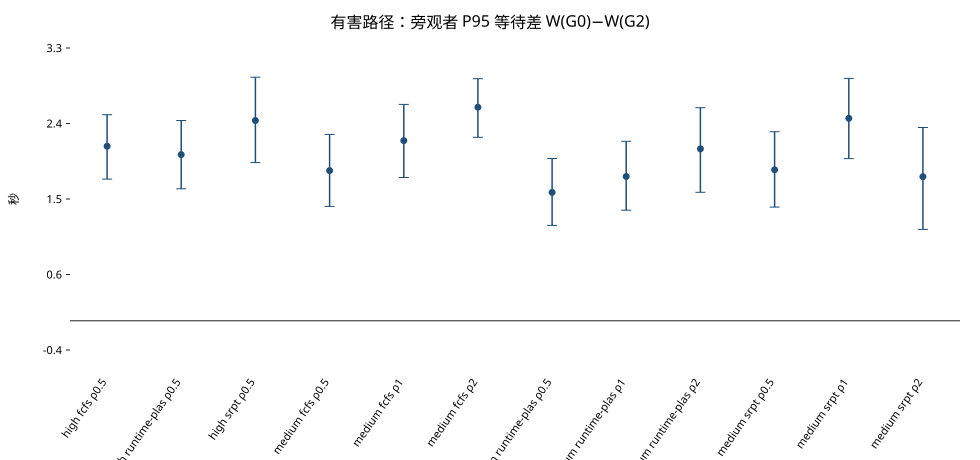
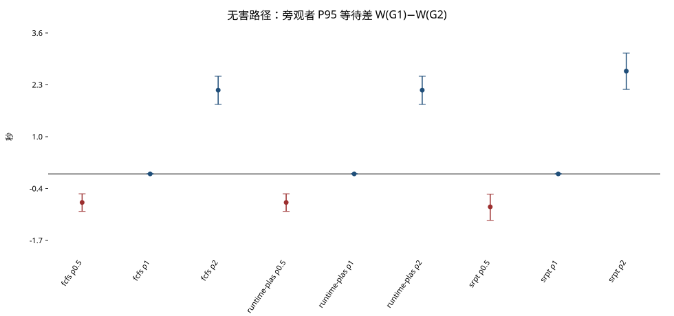
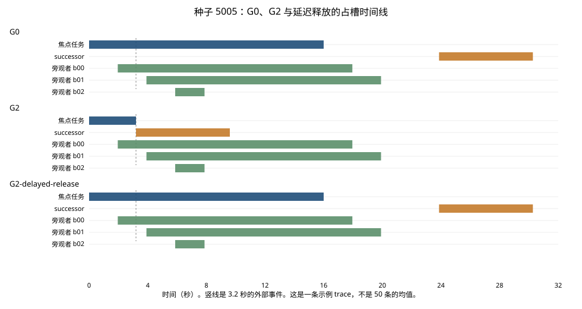

# 状态触发的在途撤销对共享队列的外部影响

Measuring the Queue Externality of State-Triggered In-Flight Revocation in Agent Runtimes

测量论文初稿。包版本 4.0.0。主数字由 3.0.0 的逻辑时钟回放生成，协议哈希 `37f9846b2504b61c4e535940f9cc4df741fe9b462d6f99458b55a40ee2138213`。确认性 JSONL 没有为这篇初稿重跑。

v1.2 的真实 API 槽位和旧提交见 [论文初稿.md](./论文初稿.md)。收尾规则和文件地图见 [项目开发文档4.0.md](./项目开发文档4.0.md)。

## 摘要

一个正在占槽的 attempt 因外部状态失去前提时，撤销政策会改变这只槽的占用，再经过后继工作和调度器，传到与这次变化无关的旁观工作流。

本文比较三种处理。G0 把失效尾巴读完再拒绝提交。G1 见相关信号就停并重做。G2 只在前提为假时停并立刻放槽。在 4 个槽、早时机的有害主格上，G2 相对 G0 的旁观者 P95 等待 12/12 格跨过预先冻结的门槛。下一只槽 600/600 交给 successor，旁观者仍然少等。前提仍成立时，效果随 restart 与剩余有效服务之比反转。完成率差为 0。排队消失时，等待差也消失。

这些句子只描述这个槽模型。它们不表示供应商已停止生成，也不表示 G2 在每一格都更好。

## 1. 问题

文献里已经有过期计划拦截、服务端版本化撤销、程序级调度和重规划预算。缺的是同一条因果链：撤销政策、后继工作量、调度器，如何作用到**没有参与这次前提变化的旁观者**。

四个问题：

| 问题 | 对照 | 成立时能写的话 |
| --- | --- | --- |
| 前提为假时，立刻放槽有没有用 | 有害，G2 对 G0 | 在写明的负载、调度和 \(\rho_h\) 下，旁观者 P95 等待变短 |
| 误撤会不会注入 restart | 无害，G2 对 G1 | 只有 restart 更长时，不误撤才让旁观者少等 |
| 调度器会不会把方向反过来 | 三种调度器 | 本实验没有看到方向反转。这不是“调度无影响” |
| 后继成本会不会把方向反过来 | \(\rho\in\{0.5,1,2\}\) | 有害方向不变；无害在 0.5 和 2 之间反转 |

G0、G1、G2 是处理组，不是新算法。

## 2. 相关工作

2026-11-04 核对。没有一篇把“未受影响的旁观者等待 × 撤销政策 × \(\rho\) × 调度器”写成主实验。Vesta 已经用 queueing externality 给额外 prefill 和 KV 传输定价，本文不声称发明这个词。PlanFence 里的 \(\rho\) 是更新强度，不是 restart 与剩余服务之比。

| 工作 | 它测量的 | 本文不重复的部分 |
| --- | --- | --- |
| PlanFence，arXiv:2609.03340 | 动作边界上的派生谱系。30 个现场工作流里挡住过期计划 | 撤销之后旁观者等多久 |
| Retire，arXiv:2610.01160 | vLLM 版本化交接。当前版本 goodput 54.0 对原生 abort 的 9.77 tok/s；修订到 successor 的 TTFT 中位数降 17.1% | 指标是被替换任务自己的交接，不是无关旁观者 |
| Agentix，NSDI 2026；Autellix，arXiv:2502.13965 | PLAS / ATLAS 按程序已完成服务调度。程序吞吐相对 vLLM 提高 4–15 倍 | Runtime-PLAS 只借用排序规则，不是那套系统的复现 |
| Vesta，arXiv:2610.14686 | 请求放在哪台机器。共置部署吞吐 +14.0%，平均 TTFT −57.8% | 槽数已经固定时，撤销政策如何改同一条队列 |
| Readiness/Release，arXiv:2609.10964 | 何时放出就绪回合。争用下工作流 P95 最多缩短 3.50 倍 | 本文处理的是已经在跑、前提变了的占槽 |
| Stop Means Stop，arXiv:2607.14166 | 六个框架的“停”没有屏障语义 | 本文假定本地停读已经发生，再测队列 |
| BRACE，arXiv:2608.01428 | 具身智能体重规划 token 减少 62–92% | 本文把 restart 的服务长度放进共享槽 |
| Root-Scoped Quiescence，arXiv:2609.21284 | 授权根撤销后的静默证书，17/17 条轨迹符合 | 不发证书，只测旁观者等待 |

可以写的差别：现有工作已经分别研究过期执行、撤销、调度和重规划。本文把状态触发的在途撤销看成共享槽上的一段服务时间，测量独立旁观者的等待，并比较前提失效与误撤销。若以后有论文做了同一主实验，这句和摘要一起改。

## 3. 定义

一次 trace 一个焦点事件。旁观者是主指标的唯一对象。

| 角色 | 是什么 |
| --- | --- |
| target | 前提会被破坏的在途尝试 |
| false target | 依赖同一来源，前提仍成立。G1 会误撤它 |
| successor | 有害事件后，同一工作流必须做的后继 |
| restart | 无害误撤后的重做 |
| bystander | 与这次事件无关的工作流 |

| 政策 | 槽和后继 |
| --- | --- |
| G0 | 占到原服务结束，提交时拒绝，然后才放 successor |
| G1 | 相关信号一到就放槽，并放入 successor 或 restart |
| G2 | 只有前提为假才立刻放槽 |
| G2-delayed-release | 有害时拒绝提交，但槽占到原服务结束。只作机制对照 |

\(\rho_h\) 是 successor 长度除以失效时的剩余服务。\(\rho_b\) 是 restart 长度除以仍然有效的剩余服务。主格取 0.5、1、2。等待是第一次拿到槽减去到达。没开始的等待记为观察窗长度，不删。\(\Delta W = W(\mathrm{baseline})-W(\mathrm{G2})\)，正数表示 G2 更短。有害基线是 G0，无害基线是 G1。

## 4. 设计

离散事件，逻辑时钟，不用模型估计 P95。焦点任务 16 秒。早时机事件在 3.2 秒，剩余 12.8 秒；中时机在 8.0 秒。旁观者 36 个，服务 2/6/16 秒，混合 40/40/20。到达在开跑前哈希。同一种子只改政策。跑得更快不会把下一次到达提前。

4 个槽。中负载到达间隔 1.9573 秒，高负载 1.7824 秒，由 FCFS+G0 的等待中位数标定，分别是 2.747 秒和 5.338 秒。调度器是 FCFS（后继入队尾）、SRPT（剩余时间来自 trace，oracle）、Runtime-PLAS（同一工作流已完成服务越多越靠后）。老化 25 秒。

每格 50 条 trace，种子 5000–5049。Pilot 的 1000–1014 不进主表。Bootstrap 以 trace 为单位，10000 次，种子 20261103。

门槛在开跑前冻结，两条同时成立才算跨过：

1. 点估计相对基线至少 10%。
2. 绝对差的 2.5% 分位大于 0。

这不是“区间证明至少改善 10%”。完成率下降超过 2 个百分点算伤害。操作检验先于队列解释：有害时 G1 与 G2 同时放槽；无害 G2 误撤为 0，G1 每条都有 restart；旧提交和重复副作用为 0。

## 5. 主结果

图由 `scripts/plot_v21_figures.py` 从 `results/experiments/v2_1/reports/v21_summary.json` 画出。



### 5.1 有害：前提已经为假

\(\Delta W_{95}=W(\mathrm{G0})-W(\mathrm{G2})\)。12/12 跨过门槛。三种调度器方向一致。没有做等效性检验，不能写“调度不影响幅度”。

| 负载 | 调度 | \(\rho_h\) | 基线（秒） | 差（秒） | 区间 | 相对 |
| --- | --- | ---: | ---: | ---: | --- | ---: |
| 高 | fcfs | 0.5 | 15.377 | 2.110 | [1.712, 2.490] | 0.137 |
| 高 | runtime-plas | 0.5 | 15.276 | 2.009 | [1.595, 2.421] | 0.132 |
| 高 | srpt | 0.5 | 15.987 | 2.421 | [1.912, 2.944] | 0.151 |
| 中 | fcfs | 0.5 | 11.796 | 1.815 | [1.382, 2.252] | 0.154 |
| 中 | fcfs | 1 | 12.893 | 2.177 | [1.731, 2.616] | 0.169 |
| 中 | fcfs | 2 | 15.451 | 2.581 | [2.218, 2.926] | 0.167 |
| 中 | runtime-plas | 0.5 | 11.533 | 1.552 | [1.153, 1.961] | 0.135 |
| 中 | runtime-plas | 1 | 12.459 | 1.743 | [1.337, 2.170] | 0.140 |
| 中 | runtime-plas | 2 | 14.947 | 2.078 | [1.552, 2.575] | 0.139 |
| 中 | srpt | 0.5 | 12.157 | 1.825 | [1.373, 2.286] | 0.150 |
| 中 | srpt | 1 | 13.626 | 2.447 | [1.960, 2.929] | 0.180 |
| 中 | srpt | 2 | 15.563 | 1.741 | [1.104, 2.336] | 0.112 |

不是每条 trace 都改善。中负载 FCFS、\(\rho_h=0.5\) 有 10/50 条差为 0。中负载 SRPT、\(\rho_h=2\) 有 9/50 条为负。去掉任意一条种子后，12 格均值仍为正，相对改善仍不低于 0.107。

完成时间同号变短，相对幅度约 0.058 到 0.100，没有一格跨过 10% 那条线。完成率两侧都是 1.0。等待和完成率分开说。

### 5.2 无害：前提仍然成立



| 调度 | \(\rho_b\) | 基线（秒） | 差（秒） | 区间 | 相对 | 门槛 |
| --- | ---: | ---: | ---: | --- | ---: | --- |
| fcfs | 0.5 | 9.981 | −0.735 | [−0.965, −0.513] | −0.074 | 否 |
| fcfs | 1 | 10.716 | 0 | [0, 0] | 0 | 否 |
| fcfs | 2 | 12.870 | 2.154 | [1.787, 2.511] | 0.167 | 是 |
| runtime-plas | 0.5 | 9.981 | −0.735 | [−0.965, −0.513] | −0.074 | 否 |
| runtime-plas | 1 | 10.716 | 0 | [0, 0] | 0 | 否 |
| runtime-plas | 2 | 12.870 | 2.154 | [1.787, 2.511] | 0.167 | 是 |
| srpt | 0.5 | 10.332 | −0.847 | [−1.195, −0.522] | −0.082 | 否 |
| srpt | 1 | 11.179 | 0 | [0, 0] | 0 | 否 |
| srpt | 2 | 13.822 | 2.642 | [2.172, 3.107] | 0.191 | 是 |

FCFS 在 \(\rho_b=0.5\) 是 32 负、18 零、0 正；\(\rho_b=1\) 是 50 条全 0；\(\rho_b=2\) 是 48 正、2 零。SRPT 在 0.5 有 2 条为正，均值仍为负，留一之后不跨过 0。FCFS 与 Runtime-PLAS 数字相同，因为无害路径上排序没有改派发，见下一节。完成率仍是 1.0。无害 G1 的 restart 是 450 次，每条一次；G2 是 0。

精确为 0 只属于早时机。中时机、\(\rho_b=1\) 时，FCFS 均值 −0.049 秒且区间跨过 0；Runtime-PLAS −0.364 秒，SRPT −0.302 秒，区间在 0 以下。这 30 条是敏感性，不进主表。

## 6. 机制

有害 G2 的下一槽是 successor，600/600。无害 G2 的下一槽是 bystander，450/450。

G0 多占的是事件之后的 12.8 秒，然后再跑和 G2 一样长的 successor。所以下一手可以是 successor，旁观者仍然少等。少等的是失效尾巴，不是“槽直接给了旁观者”。



种子 5005、FCFS、\(\rho_h=0.5\)：G2 在 3.2 秒放槽，P95 为 6.374 秒。G0 和延迟释放都在 16.0 秒放槽，P95 都是 11.163 秒。20 条边界格上，延迟释放和 G0 的均值都是 14.233 秒。这 20 条不与 50 条主格同等强度。种子 5000 上三臂 P95 同为 2.235 秒，所以单条 trace 可以没有差距。图是例子，均值以第 5 节为准。

Runtime-PLAS 相对 FCFS：无害路径 7399 次可比较派发，顺序不同 0 次。有害 G2 上也没有不同。差异出现在有害 G0，大约四分之一的决策，因为失效任务一直占槽，已完成服务才在旁观者之间拉开。有害格子里两种调度的幅度差来自 G0 基线，不是 G2 被两种调度器以不同方式执行。

低负载到达间隔 20 秒时，等待中位数是 0，\(\Delta W_{95}\) 也是 0。没有排队，就没有旁观者收益。

没有做中介分析。延迟释放说明：只撤销、不立刻放槽，等待和 G0 一样。这还不是“失效尾巴是唯一通道”。

## 7. 边界实验

每格 30 条，种子 12000–12029，不进主表。到达间隔不重新标定。

| 扰动 | 有害方向 | 无害 0.5 / 1 / 2 | 和主门槛的关系 |
| --- | --- | --- | --- |
| 服务时间或到达 ±25%，三种长度混合 | 仍为正，FCFS 相对约 0.11–0.15 | 负 / 零 / 正 | 早时机的模式还在 |
| 2 个槽 | 绝对差约 6–12 秒，区间下界大于 0 | 同样反转 | 相对幅度常低于 10%，因为基线本身很大 |
| 8 个槽 | 绝对差约 0.01 秒，区间含 0 | \(\rho_b=0.5\) 的差变成 0 | 基线接近 0，相对值不可解释 |
| 中时机 | FCFS 相对约 0.08–0.10，方向为正 | \(\rho_b=1\) 不再精确为 0 | 不升格进主句 |

真实 API 60 条，种子 9100–9109，`max_inflight=2`，传输错误 0。旧提交 0。无害误撤是 G1 的 10/10、G2 的 0/10。有害 G2 的撤销、本地停读、放槽都出现；9/10 的顺序是撤销、停读、放槽，种子 9104 的放槽早 0.015 秒。两个任务同时在飞，第二个不是排队旁观者。没有调用供应商取消接口。这 60 条不与回放秒数相加。

## 8. 限制

服务时间和 \(\rho\) 由协议设定。方向反转说明的是这个模型里改变 restart 比率会改变队列，不是所有 Runtime 的最优阈值。SRPT 知道剩余时间。8 个槽或低负载下收益消失。完成率在排水窗口内都是 1。v1.8 的 980 行没有角色字段。客户端停读不是 GPU 或 KV 已回收。

## 9. 结论

在 4 个槽、冻结到达率和早时机下，前提失败后立刻放槽缩短了旁观者 P95 等待，12/12 个有害主格跨过门槛，三种调度器方向一致。槽可以先交给 successor。只撤销而不放槽，等待与继续占槽相同。前提仍成立时，restart 更短则误撤让旁观者少等，restart 更长则不误撤更好。没有排队时，等待差消失。完成率没有差。

## 复现

```powershell
python -m uv run python scripts/analyze_v21.py
python -m uv run python scripts/plot_v21_figures.py
```

主表在 `results/experiments/v2_1/`。图和审计在 `results/experiments/v4_0/`。
