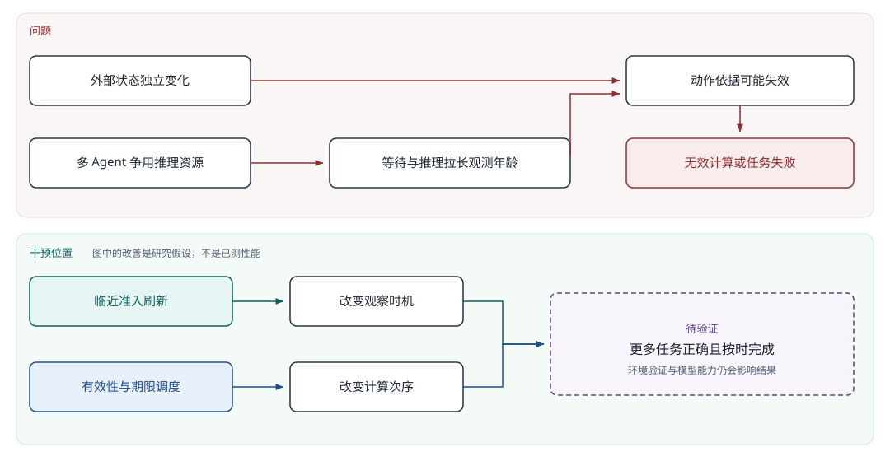
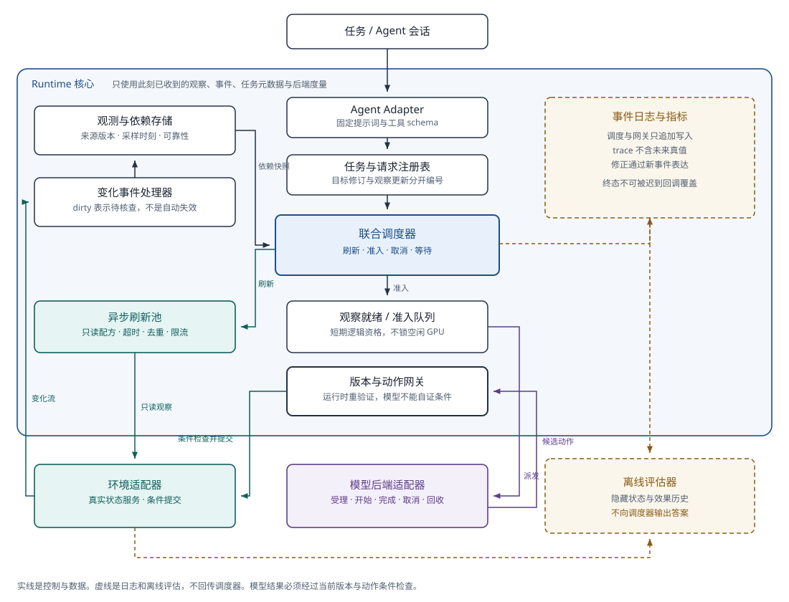
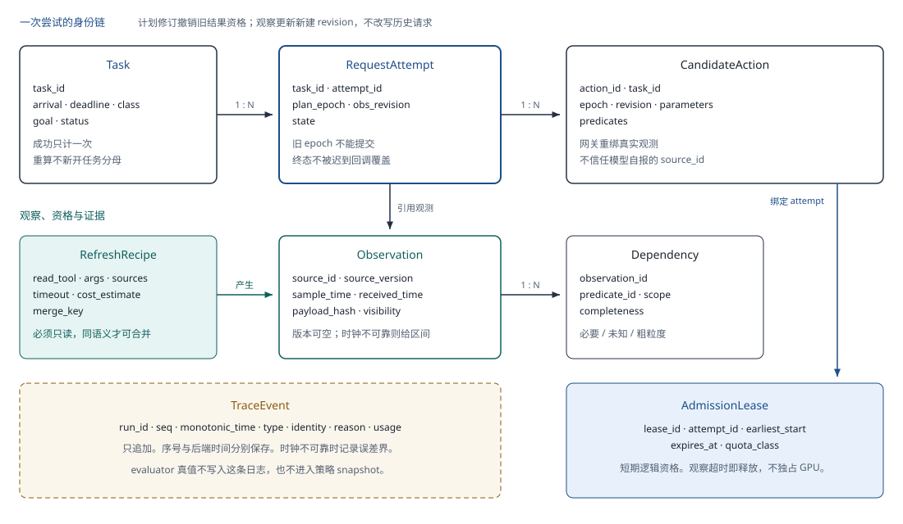
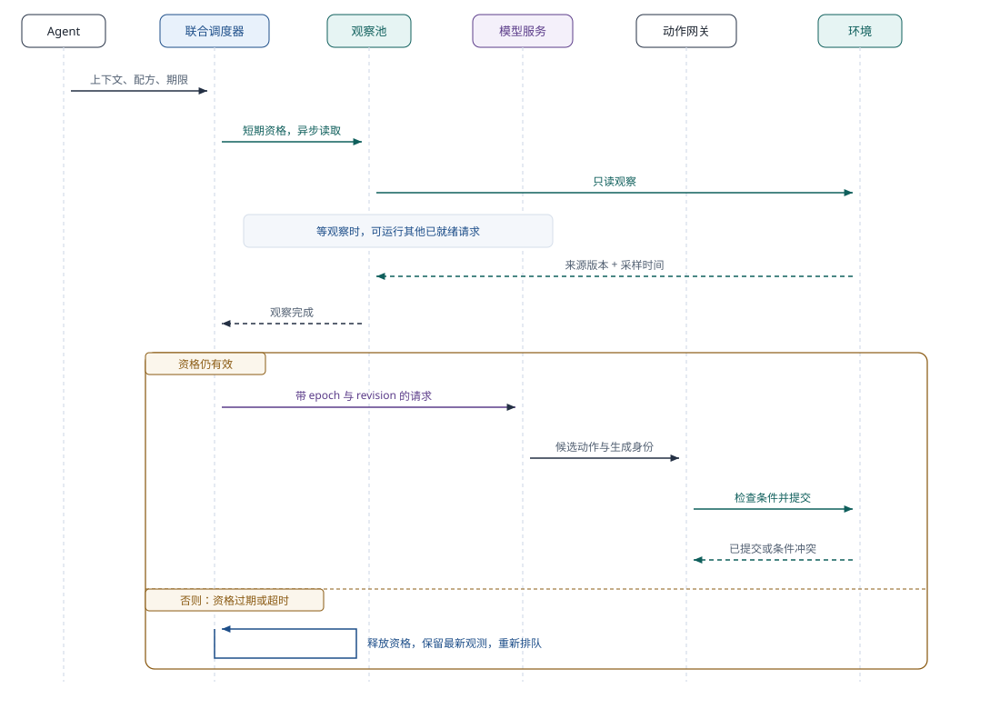
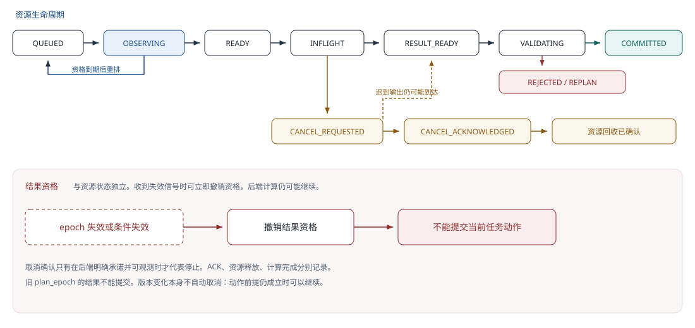
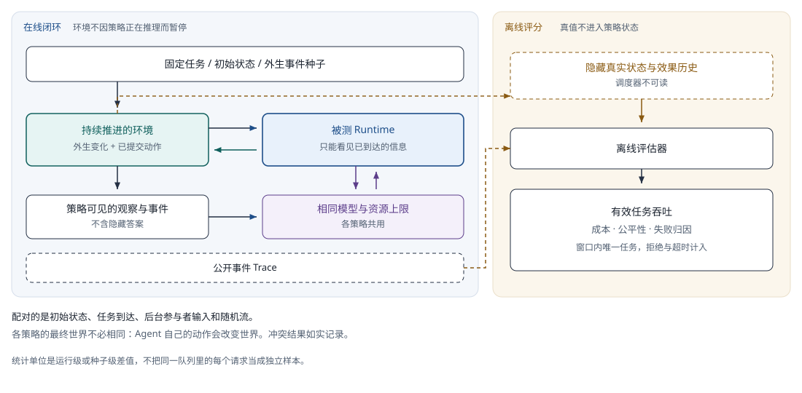
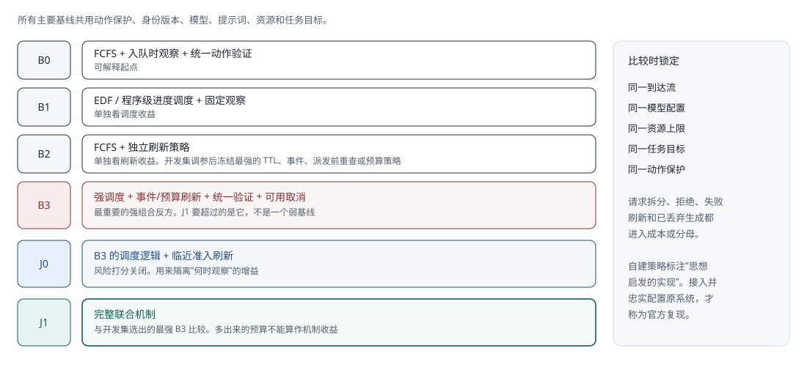
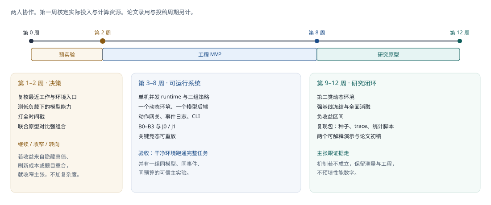

# 面向动态环境的 Agent Runtime 项目开发文档

| 项 | 内容 |
| --- | --- |
| 英文工作标题 | Freshness-Aware Scheduling for LLM Agents in Dynamic Environments |
| 文档状态 | 研究设计 + **v0.1 可运行骨架**（Fake 环境/后端 happy path）。完整实验尚未运行，创新性尚待验证 |
| 版本 | v1.1 · 2026-10-24（增补工程骨架） |
| 工程说明 | 见同目录 [工程实现说明.md](./工程实现说明.md) |
| 规划假设 | 两人协作。先做两周预实验；约八周工程 MVP，约十二周研究原型。实际投入与计算资源在第一周核定 |
| 资料截止 | 2026-10-23。未独立复现所引作者系统，正式立项与投稿前再查新 |
| 来源 | 由《项目设计书》整理。本文是开发与实验的实施规格，不是已测性能报告 |

项目要回答：当多个 Agent 共享有限推理资源，而外部世界在等待与推理时继续变化，runtime 应何时重新观察、先计算什么、何时停止失效工作，才能让更多任务正确且按时完成？

## 阅读地图

| 你要做的事 | 先看 |
| --- | --- |
| 跑通当前代码 demo | [工程实现说明.md](./工程实现说明.md) |
| 理解为什么做、做到什么算成功 | [1. 项目总览](#1-项目总览)、[3. 问题定义](#3-问题定义与研究假设) |
| 搭系统 | [6. 系统架构](#6-系统架构)、[7. 数据模型与接口](#7-数据模型接口与可见性)、[工程实现说明.md](./工程实现说明.md) |
| 写调度与网关 | [8](#8-核心机制一临近准入的观测刷新)–[10](#10-核心机制三失效取消与执行边界) |
| 做实验 | [5. 场景](#5-场景与工作负载)、[11. 实验](#11-实验设计与指标) |
| 排两周和十二周 | [12. 里程碑](#12-里程碑与两周决策)、[15. 交付](#15-交付物与验收) |

## 1. 项目总览

### 1.1 定位

本项目是面向高层工具 Agent / 技能 Agent 的研究型执行与调度系统。它连接环境观察、模型服务和动作执行，管理请求生命周期、观测版本、刷新时机、共享资源与失效处理。服务的场景是：任务会持续执行，环境会自主变化，模型调用会排队。

研究目标是在固定模型与计算预算下，提高**有效任务吞吐量**：单位时间内正确且在截止时间前完成的任务数。任务正确性由环境验证器判断。计算完成、输出格式合法、动作被网关接纳，都不能直接算任务成功。

工程上要能解释背压、准入、版本传播、并发竞态、可观测性、取消与资源回收，并用实验说明取舍。高层调度接口以后可以往具身技能迁，但低层运动控制、感知建模和真实机器人安全是另外的工作，见 [14. 具身迁移](#14-具身迁移与能力边界)。

### 1.2 三层产物

| 层次 | 计划产物 | 成功依据 |
| --- | --- | --- |
| 工程 | 单机并发 runtime、环境与模型适配器、调度策略、动作网关、CLI、事件日志 | 干净环境可运行；生命周期和边界清楚；关键竞态可重放 |
| 研究 | 问题测量、强组合基线、联合机制、消融、负收益区间、复现包 | 同模型、同事件、同预算的对照支持结论；结果能被复核 |
| 展示 | 两个可解释演示、架构与时序图、五分钟讲解、个人职责记录 | 能说明问题、机制、证据和局限；所有数值来自实际测量 |

目前已完成：选题资料、设计文档，以及仓库内 **v0.1 工程骨架**（`src/epochgate`、Fake happy path、pytest）。完整 runtime 能力、强基线实验、论文初稿仍为待交付成果。不预设提升比例、发表结果或开源影响力。

### 1.3 范围

MVP 覆盖：一个本地动态 API 环境、一个模型服务接口、多会话共享并发预算、完整事件 trace、三组核心策略。

研究版增加：可控制的真实推理后端、强基线、第二类动态环境、全面消融。

首版不做：训练基础模型、操作系统内核、通用分布式事务、多 GPU 内核调度、机器人连续控制、GUI 产品。沿用普通持久化与日志。此前 BoundRun 的故障恢复研究只作背景，不与本课题合成两条主线。崩溃恢复性能不进主要实验。

## 2. 背景与痛点

### 2.1 问题结构

自动办事系统可能读完空闲日程再排队，按旧库存下单，或按已失效的审批状态继续处理。协作机器人也可能按旧的对象位置发出高层技能。共同点是：Agent 的计算与世界变化同时发生。

后果包括重复工作、错过时限、反复核查、人工接管变多、模型成本花在无效计算上。这里描述的是问题结构，不是行业发生率或损失金额。项目用公开环境和受控服务验证机制，不把合成负载的比例外推成生产统计。

### 2.2 四类状态与观测年龄

Agent 循环里有四类状态：内部计划、外部环境、执行资源、已经产生的动作效果。

- 内部 checkpoint 不会让外部世界停止变化。
- 更快生成 token 不保证任务成功。
- 新鲜观测也不保证模型计划正确。

对某项观测：

```text
观测年龄 Δobs = 动作提交时刻 t_commit − 来源采样时刻 t_sample
```

这段时间可以包括观测传输、runtime 排队、后端排队、推理、验证、执行器等待。各项用独立时间戳测量，嵌套时段不能加两次。多来源动作保留每项依赖的年龄；只有汇总展示时才报告最大值或分位数。

时间年龄和决策有效性不是一回事。来源版本变了，动作前提仍可能成立；刚读到的状态也可能马上失效。TTL 和变化风险估计只指导资源分配。动作许可仍依赖具体条件。



### 2.3 文献里已经有什么，本项目还要验证什么

不能把“加入 freshness 字段”“刷新旧上下文”或“版本检查”写成首创。

| 证据线 | 文献已经支持的内容 | 本项目仍要验证 |
| --- | --- | --- |
| 动态环境 | Gaia2、RealtimeGym 把异步变化和计算时间纳入任务；RRARA 关注反应延迟 [14][15][16] | 合理并发下，有多少失败和计算浪费可以归因于观测失效 |
| 推理服务 | Autellix 关注程序级服务，GoodServe 关注 SLO 与资源 [2][13] | 加上环境有效性之后，单独的服务调度是否已经够用 |
| 有效性维护 | Concord 追踪观测来源；ATR 用决策条件与选择性重验证；ERRAND 研究预算刷新 [8][11][12] | 刷新与准入的协同是否优于这些思想的合理组合 |
| 具身与新鲜度 | TypeGo 的未来工作涉及成本策略；Beyond LLM Serving 讨论新鲜度接口，并写明未实现调度器 [6][17] | 能否做出具体在线机制，并给出跨环境的闭环证据 |
| 既有理论 | Task-oriented AoI 研究精度与时效；Speedup Paradox 讨论单步加速和任务结果 [18][19] | 多步任务、工具副作用、刷新产生新请求，会多出什么约束 |

保留这些限制：Concord 相关评测只有 40 个 HotpotQA 派生任务和受控文件修改；ATR 的正确性依赖可靠验证器、完整依赖和目标侧原子检查；Beyond LLM Serving 已经提出接口方向。

## 3. 问题定义与研究假设

### 3.1 系统模型

到达流中每个任务 `j` 有到达时间 `a_j`、期限 `d_j`、固定任务目标和任务类别。任务可以产生多次模型请求。请求可以依赖多个来源。刷新会产生新的观测或新的请求版本。多个会话共享模型服务、观察工具和动作执行资源。

runtime 在时刻 `t` 只能使用 `O(t)`：截至此时已经收到的观察、事件、任务元数据和后端度量。外部参与者未来会做什么、隐藏任务答案、离线验证器的真值，都不在可见集合里。世界状态由“外部变化 + Agent 已提交动作”共同演化。

决策动作包括：延后观察、发起刷新、授予短期准入资格、派发模型请求、继续计算、请求取消、废弃结果、重新规划、等待补证据、结束任务。任务拒绝和超时必须计入统计。

### 3.2 目标与约束

```text
G_task = 测量窗口内正确且按时完成的唯一任务数 / 测量窗口长度
```

固定到达窗口 `[0, T)`。只计在该窗口内到达、且在 `min(d_j, T)` 前完成的任务，避免把窗口外补跑当成吞吐收益。窗口末未完成的任务继续跟踪到各自期限，用于 cohort 成功率和尾部行为，另行报告 drain 时长。

比较必须在相同到达流、模型配置、资源上限和任务难度下进行。请求拆分、重复提交、被拒任务、失败刷新、已丢弃的模型生成，都进入成本或分母。同时看计算预算、工具限流、每任务刷新预算、取消能力、可见性与公平性约束。

不预设全局最优，也不把启发式策略称为理论最优。首版目标是可解释、可实现、能被消融检验的在线机制。

### 3.3 可证伪的研究问题

| 研究问题 | 待检验假设 | 什么证据会推翻或收窄它 |
| --- | --- | --- |
| RQ1：浪费是否显著？ | 在部分合理负载与变化强度下，依据失效会造成可测量的计算浪费 | 只在极端合成条件出现；主要失败其实来自模型能力 |
| RQ2：需要协同吗？ | 观察时机与资源准入互相影响，联合机制优于最强独立组合 | EDF 或程序级调度加上合理刷新，已经达到同样结果 |
| RQ3：何时不值得？ | 低变化、低负载、昂贵观察、弱取消会缩小或消除收益 | 机制不能在这些区域退回低开销路径 |
| RQ4：能否迁移？ | 同一套核心接口能服务软件工具和第二类动态任务 | 收益依赖某个环境的隐藏状态，或大量定制策略 |

RQ4 是研究版扩展。两周预实验优先回答前三项。

## 4. 差异化与贡献边界

候选贡献有三项，都还没被实验证实：

1. **测量。** 用真实计算时间和独立环境变化，定位“结果已经生成，但依据已经失效”的频率和资源代价。
2. **协同机制。** 把可延迟的观察配方、短期准入资格、观察就绪队列、成本与有效性信号接起来，处理观察资源与模型资源错配、重复刷新和取消延迟。
3. **证据。** 在强组合基线之上给出闭环结果、适用区间和失败案例。若机制增益不成立，保留测量和工程贡献，改论文定位。

| 工作 | 必须承认的重叠 | 本项目待验证的差别 |
| --- | --- | --- |
| Autellix / GoodServe [2][13] | 请求次序、程序进度、SLO | 把易变观测的获取时机和多请求准入放在一起控制 |
| Concord / ATR [8][11] | 来源、失效、动作条件、重验证 | 在提交检查之前减少注定失效的计算。所有方法共用动作保护 |
| ERRAND [12] | 按成本和价值分配刷新预算 | 多任务争用推理服务时，刷新和排队的反馈关系 |
| REVISE / Versioned Execution [7][10] | 版本切换、无效输出隔离与取消 | 持续环境变化下的在线资源分配，而不是修订之后的恢复 |
| TypeGo / RRARA [6][14] | 技能执行、快慢频率、异步响应 | 共享推理服务上的任务间协调，先在高层技能验证 |
| Beyond LLM Serving / TAoI [17][19] | 时效接口，精度与延迟的权衡 | 可运行策略、多步任务和工具副作用的闭环实测 |

AIOS 的 OS 抽象 [1]、Continuum 的 KV 保留 TTL [3]、Crab / DART 的检查点与恢复 [4][5]、TomasuLLM 的推测执行 [9]、ToolGate / REFINEACT 的动作契约 [20][21] 是背景。持久执行可参考 LangGraph 的能力和幂等要求 [22]。这些已有机制不是本项目的主要创新。

## 5. 场景与工作负载

### 5.1 主场景：动态预约与共享库存

任务读取若干资源，比较候选，做出带条件的预约或扣减。独立后台参与者按预先生成的外生事件修改资源。每次读取返回来源版本和采样时刻。写入在 provider 内原子判断前提并提交，拒绝原因可追踪。

任务至少要有一次真实模型决策。确定性 planner 可以做协议测试和方差分解，不能替代主要 LLM 实验。先在低负载、低变化下测任务能力，确认模型做得出这些任务。

### 5.2 公开环境

研究版优先筛选 ARE / Gaia2 的动态子集 [16][23]。第一周确认许可证、执行入口、环境推进方式、任务验证器、模型接入和时间成本。若要修改，命名为自建派生子集，保留 patch，不报告为官方榜单结果。

第二类环境优先考虑 RealtimeGym 的时间模式 [15][24]。若任务和动作粒度不匹配，记下原因再换另一个公开环境。不能换成静态任务，也不能在推理时暂停世界。真实机器人是有合作条件之后的独立扩展。

### 5.3 配对什么，不配对什么

同一份外生事件计划，不代表各策略经历完全相同的最终世界：Agent 自己的动作会改变世界。配对的是初始状态、任务到达、后台参与者的输入和随机流。后台修改按当时状态执行，冲突结果如实记录。

## 6. 系统架构



### 6.1 组件

| 组件 | 输入 / 输出 | 职责与边界 |
| --- | --- | --- |
| Agent Adapter | 任务、稳定上下文 → 决策请求 | 固定提示词和工具 schema。暴露依赖，避免历史摘要继续引用被废弃的事实 |
| Registry | 任务、计划 epoch、attempt → 当前身份 | 任务目标修订和观察更新分开编号。终态不能被迟到回调覆盖 |
| Observation Store | 来源、版本、采样时刻、payload → 依赖快照 | 保留已观察版本和可靠性。未知依赖显式标记 |
| Event Handler | 变化通知、断流、乱序事件 → dirty / unknown | dirty 表示待核查，不等于决策失效。断流不等于状态稳定 |
| Refresh Pool | 只读观察配方 → 新观测或错误 | 独立并发、速率限制、超时、去重。不允许隐藏写操作 |
| Scheduler | 可见状态与服务能力 → 刷新、准入、取消、等待 | 同时考虑短期供给、期限和刷新代价。每次决定写下理由 |
| Backend Adapter | 提示词和身份 → 输出、usage、取消证据 | 区分受理、计算开始、完成、取消与回收。未知字段不伪造 |
| Action Gateway | 候选动作、依赖、epoch → 提交 / 拒绝 / 等待 | 模型不能自行声明条件已满足。原子性由目标侧能力决定 |
| Trace 与 Evaluator | 事件 → 指标与复现 | trace 不含未来真值。离线判分和在线策略分开 |

### 6.2 建议技术栈

这是建议清单，不表示已经安装或验证过这些后端。首版只选一个推理后端。只有主结论需要交叉验证时才扩展。

| 层 | 建议 | 原因与待确认项 |
| --- | --- | --- |
| 核心 | Python 3.12、asyncio、类型化 dataclass / Pydantic | 便于接模型和环境。单事件循环简化状态更新。版本锁在 lockfile |
| 环境服务 | FastAPI、SQLite 事务、可重复种子 | 需要真实读写和条件提交。SQLite 适合单机原型，不是分布式保证 |
| 模型接口 | 统一 HTTP 流式适配。API pilot 之后接 vLLM 或 SGLang 之一 | 先探测 cancel 和服务端指标。OpenAI 兼容接口不能用来证明 GPU 已回收 |
| 状态与 trace | 内存状态机 + SQLite 索引 + JSONL / Parquet 导出 | 低延迟执行和离线统计分开。主实验不额外背崩溃恢复 |
| 实验 | pytest、Hypothesis（竞态序列）、pandas、SciPy、Matplotlib | 测协议、算区间、导出正式图。工具版本锁定 |
| 交付 | uv、Typer。Docker 和一层 LangGraph 薄适配可选 | 优先原生循环。适配框架不改变研究对象 |

## 7. 数据模型、接口与可见性

下面的接口是待实现契约，不是当前可调用的 SDK。



| 实体 | 关键字段 | 约束 |
| --- | --- | --- |
| Task | task_id、arrival、deadline、class、goal、status | 一项业务任务只计一次成功。重算不创建新的任务分母 |
| RequestAttempt | task_id、plan_epoch、obs_revision、attempt_id、state | 计划修订撤销旧结果资格。观察更新新建 revision，不改写历史请求 |
| Observation | observation_id、source_id、source_version、sample_time、received_time、payload_hash、visibility | source_version 可为空。跨服务时钟不可靠时记录时间区间 |
| Dependency | observation_id、predicate_id、scope、completeness | 显式区分必要依赖、未知依赖、粗粒度依赖 |
| RefreshRecipe | read_tool、args、sources、timeout、cost_estimate、merge_key | 必须只读。只有同租户、同权限、同参数、同语义的读取才能合并 |
| AdmissionLease | lease_id、attempt_id、earliest_start、expires_at、quota_class | 短期逻辑资格，不独占 GPU。观察超时即释放 |
| CandidateAction | action_id、task_id、epoch、revision、parameters、predicates | 运行时重新验证绑定。不能信任模型输出的任意 source_id |
| TraceEvent | run_id、seq、monotonic_time、type、identity、reason、usage | 序号和后端时间分别保存。只追加，修正用新事件表达 |

```python
class EnvironmentAdapter:
    async def observe(self, recipe) -> ObservationBatch: ...
    async def changes(self, cursor) -> AsyncIterator[ChangeEvent]: ...
    async def check(self, candidate) -> ValidationResult: ...
    async def commit(self, candidate, conditions) -> CommitResult: ...

class InferenceBackend:
    def capabilities(self) -> BackendCapabilities: ...
    async def submit(self, request) -> BackendHandle: ...
    async def cancel(self, handle) -> CancelReceipt: ...
    async def events(self, handle) -> AsyncIterator[BackendEvent]: ...

class SchedulingPolicy:
    def decide(self, visible_snapshot) -> list[Decision]: ...
```

`commit` 必须说明条件检查是否和效果提交原子绑定。若不支持，输出对应 capability 和竞态窗口。`cancel` 返回的是后端证据类型，不能统一写成“GPU 已回收”。策略只接收裁剪后的 snapshot，不能持有 evaluator 引用。

### 7.1 时钟与事件

单机持续时间用 monotonic clock，展示时间另存 UTC。采样时间由受控来源记录，回包时间由客户端记录。跨主机采样时间如果不能可靠映射，记录同步误差界或年龄上下界，不报告虚假的精确毫秒。

事件携带来源序号、观测版本、接收时间和游标。乱序、重复、断流、延迟都可以注入。事件丢失时做保守重查，或退回 polling。快照生成和事件订阅之间的空隙，用游标衔接或重新采样补上。

## 8. 核心机制一：临近准入的观测刷新

传统路径容易先观察，再排很长的队。本方案允许请求先带着稳定上下文和只读刷新配方入队。调度器估计下一段时间的服务容量，给有限数量的请求发短期准入资格，并异步刷新易变观测。只有观察完成且资格仍有效的请求，才进入观察就绪队列。

准入资格是逻辑名额，不锁住一块空闲 GPU 等网络返回。后端有容量时可以跑其他已经就绪的工作。资格数量以并发槽为基础上限。连续批处理后端只能把它当成近似控制，必须同时测量实际后端等待。



防止空转：

- 每个任务有刷新次数、费用和总时长上限。相邻刷新的最小间隔在开发集上调，然后冻结。
- 无关来源变化不触发全量重算。相同且已收到的版本不重复刷新。
- 资格过期后，用新观测和预计等待重新评估，不一律丢掉刚采到的数据。
- 可以合并的是同一种读取语义。不同业务意图、有意重复的两次动作、不同租户权限，不能合并。
- 默认不复用旧模型输出的中间推理。若实现稳定前缀复用，要单独消融，并且所有可比策略都能用到。

## 9. 核心机制二：有效性、成本与公平性

首版先做规则策略，避免把系统收益和复杂学习策略混在一起。

1. 处理任务终态和明确修订，隔离已经没有资格的结果。
2. 更新来源 dirty 状态，对受影响依赖做能做的轻量验证。动作前提已被证实仍然成立时，版本变化不必自动取消。
3. 用历史服务耗时估计完成时刻。尚可按时完成的任务才安排刷新或就绪执行。截止时间已经无法达成时，明确计入 timeout / infeasible，不从分母里拿掉。
4. 在普通服务份额内，优先选预计能按时、条件可用、单位成本收益较高的请求。元数据不够时退回 EDF / FCFS。每次 fallback 写入 trace。
5. 留出一部分派发机会给等待最久的可执行任务。按任务类别看成功率和最大等待。频繁变化的短任务不能永远挤掉稳定的长任务。

可解释原型的候选打分是：

```text
U(i, a) = [P̂(截止前完成 | O(t), a) × P̂(完成时条件可用 | O(t), a)]
          / [Ĉ_model(i, a) + κ · Ĉ_observe(i, a) + ε]
```

`a` 是立即执行、先刷新或继续等待。成本先换成一种明确单位，例如估计的后端服务秒。`κ` 是把观察成本映射到该单位的固定权重。美元、token、时间不能直接相加。任务默认等权，不按动作数增加收益。

这不是完整的任务成功概率。模型能力和多步依赖会带来额外误差。可以先用“预计剩余时长 + 保守条件可用率”实现，再和只用 EDF 的版本比较。风险模型只用历史可见事件。版本变化率也不直接等于决策失效率。

v0 可以把来源条件失效率做成在线滑动统计，敏感性实验里使用 `exp(-λ̂ · Δ)` 近似。这个形式是可替换假设。必须加入突发、非平稳和缺失事件的负例，以及关闭风险估计的消融。

公平份额、最大等待告警、每任务刷新上限在开发集选定后冻结。所有基线使用相同的基本 admission 上限。持续过载或期限已经不可完成时，不保证所有任务成功。报告可执行任务的服务份额和长等待，不承诺无条件无饥饿。

退化：

- 低变化或低负载：直接沿用当前观测。
- 观察很贵：延后刷新，或继续已经验证过的工作。
- 后端不能可靠取消：优先减少派发之前的无效工作。
- 策略切换用固定条件和滞回，避免一次事件就来回切。

## 10. 核心机制三：失效、取消与执行边界

请求执行状态描述资源生命周期。结果资格描述输出还能不能作用于当前任务。收到失效信号时可以立刻撤销结果资格，但后端计算可能还在继续。



| 编号 | 实现必须维持的约束 | 怎么验证 |
| --- | --- | --- |
| I1 | 旧 plan_epoch 的结果不能提交当前任务动作 | 旧输出与修订并发的事件序列测试 |
| I2 | 每个候选动作绑定真实观测和合法依赖。模型不能伪造资格 | 非法 source_id、缺失依赖、摘要污染用例 |
| I3 | 有原子条件写入能力的 provider，在同一提交点检查条件 | 在检查和写入之间注入并发改变 |
| I4 | 取消请求、取消确认、资源释放分别记录 | 模拟延迟 ACK、取消失败、完成与取消竞态 |
| I5 | 刷新不隐含业务写入。预算和限流不能绕过 | 观察工具 allowlist、配额与失败重试测试 |
| I6 | evaluator 真值不进入策略状态 | 接口隔离审查，审计可见字段 |
| I7 | 终态唯一。重算不重复计任务，也不重复做业务提交 | 并发回调、重复事件、幂等键测试 |

这些是限定模型里的工程约束，不是全局安全定理。事件通知只提供线索。TTL、置信度，以及“没有收到变化”，都不能替代动作前提。

外部副作用：

- 受控 provider 可以用事务或 CAS 把验证和效果提交绑在一起。
- 远端不支持时，网关先检查再调用，仍然存在 TOCTOU 窗口。要记下能力和实际失效执行。不能宣称跨系统原子提交或通用 exactly-once。
- 受控系统可以在动作网关串行化“撤销资格 / 派发”。已经被远端合法接纳的动作可能稍后才完成。撤销不自动回滚旧效果。按工具的接纳语义或提交语义评价，并记录实际线性化点。
- 观察更新使计划里的总结或推断失效时，首版保守重建本轮决策提示词。只替换一条工具消息、却继续沿用旧事实推导，会留下隐藏的过时依赖。

## 11. 实验设计与指标



所有主要基线共用动作保护、身份版本、模型、提示词、资源和任务目标。



| 编号 | 策略 | 用途 |
| --- | --- | --- |
| B0 | FCFS + 入队时观察 + 统一动作验证 | 可解释起点 |
| B1 | EDF / 程序级进度调度 + 固定观察 | 测量单独的调度收益 |
| B2 | FCFS + 独立刷新策略 | 测量单独的刷新收益 |
| B3 | 强调度 + 事件/预算刷新 + 统一验证 + 可用取消 | 最重要的强组合反方 |
| J0 | B3 的调度逻辑 + 临近准入刷新，风险打分关闭 | 隔离“何时观察”的增益 |
| J1 | 完整联合机制 | 与开发集选出的最强 B3 比较 |

独立刷新族包括固定 TTL、事件触发、每次派发前重查、预算/价值策略。在开发集上给它们公平的调参预算，最后冻结最强组合。借鉴 Autellix、Concord、ATR、ERRAND 的自建策略，必须标注“思想启发的实现”。只有实际接入并忠实配置作者系统，才称为官方复现。

| 指标 | 口径 |
| --- | --- |
| 有效任务吞吐量 | 正确且按时完成的唯一任务 / 固定测量时长。主指标 |
| cohort 成功率 | 所有到达任务里、截止前成功的比例。包含拒绝和超时 |
| 过时动作 | 候选失效、网关拦截、provider 拒绝、真实失效提交，分开计数 |
| 可确认浪费 | 因失效而不能再用的请求实际生成的 token。服务端可见时，记录回收前的计算 |
| 观测年龄与延迟 | 各依赖年龄；排队、推理、验证、提交；变化后有效响应的 p50 / p95 |
| 观察和取消代价 | 读取次数、失败、费用、网络、取消延迟、残余生成 |
| 公平性 | 任务类别成功率、等待分位数、最长等待、未完成比例 |
| 机制开销 | 调度 CPU、元数据、日志、空闲服务比例、准入资格过期 |

批处理 GPU 上，单请求占用时间不能简单加总成 GPU 秒。GPU 利用率按整体运行窗口统计。单请求估算必须声明归因方法。API 模式只报告可见 usage、客户端延迟和真实账单。断开连接不能用来证明节省了 GPU。

必要消融：去掉临近刷新、去掉有效性打分、去掉早期取消（仍然丢弃旧结果）、去掉细粒度依赖、去掉公平保护。

负例：静态环境、低负载、昂贵观察、后端不可取消、通知缺失、突发变化。

实验按任务和事件种子配对，策略顺序随机化。统计单位是运行级或种子级差值，不把同一共享队列里的每个请求当成独立样本。报告 95% 区间、样本量、绝对值和相对变化。样本量和可接受增益由预实验方差和预算确定，最终评测前冻结。

## 12. 里程碑与两周决策



第一周：复核最近工作，确认环境能接入，建立真实模型的能力基线，打全时间戳。

第二周：比较简单联合原型和强组合基线，形成继续、收窄或转向的决定。

继续的证据应包括：多组合理条件下存在失效浪费；联合机制优于强组合，而且不是多花预算造成的；长任务和拒绝率没有把代价掩盖掉；信息隔离成立。

若合理基线已经解决问题、收益只来自隐藏真值、刷新成本吞掉收益，或最近工作完全重合，就交付可复用的工程和测量，收窄论文主张。不为维持题目增加复杂度。

八周 MVP 的验收是可运行系统，加上一组可信主实验。十二周目标增加第二环境、完整复现和论文初稿。论文录用和投稿周期另计。

分工默认是：A 负责 runtime，B 负责环境与评测。每个里程碑交叉检查。

## 13. 风险与应对

| 风险 | 早期信号 | 应对 |
| --- | --- | --- |
| 创新重叠 | 新论文已经实现相同机制；B3 与 J1 持平 | 维护最近邻对照。转成测量和系统经验，不换一套术语重新包装 |
| 环境过于人工 | 只有极高变化率或故意放慢的模型才有收益 | 按自然服务速度和合理变化校准。加入公开环境，报告全部参数 |
| 观察不可见 | 变化只存在于 evaluator | 禁止真值注入。研究 polling 和部分可见性，必要时收窄范围 |
| 后端不可控 | 取消之后 GPU 仍在工作；队列长度被藏起来 | 做能力探测和服务端指标，限制在途请求。GPU 主张等到可观测之后 |
| 重刷与饥饿 | 资格频繁过期；长任务没有进度 | 预算、退避、服务份额、原因计数。过载不承诺全部成功 |
| 模型能力不足 | 静态、低负载任务也失败 | 简化任务或更换可运行的模型，先固定能力基线。不用调度掩盖能力问题 |
| 统计失真 | 多种子差异大；只挑选有利子集 | 预注册、配对、运行级区间、公开完整矩阵 |
| 范围失控 | 同时做恢复、机器人、RL、多 GPU | 固定一个主环境和一个后端。扩展必须过预实验门槛 |
| 两人资源不足 | 测试和实验没人维护；GPU 排期不稳 | A 做 runtime，B 做环境与评测，里程碑交叉检查 |

## 14. 具身迁移与能力边界

| 层次 | 软件 API | 具身高层技能 | 迁移判断 |
| --- | --- | --- | --- |
| 观察 | 有版本的字段 | 感知、定位、对象状态 | 元数据可以共用。误差和时钟语义要重做 |
| 任务版本 | 工作流目标修订 | 技能目标更新 | epoch 和迟到输出隔离可以共用 |
| 资源调度 | 模型、工具限流 | 模型、感知、技能资源 | 核心调度可复用。资源能力要重新建模 |
| 条件提交 | CAS / 事务 | 技能启动条件 | 启动检查覆盖不了执行全程 |
| 取消 | 后端停止生成 | 执行器安全停止 | 两种操作分开。需要控制器给出停止反馈 |
| 回滚 | 部分 API 可补偿 | 物理效果通常不可逆 | 仿真 reset 不代表真实可回滚 |

没有真实控制与感知工作时，不把经历写成机器人低层控制或 VLA 训练。VLA 服务可能是 batch-1 或非自回归动作头，不能把文本 LLM 后端的调度结论直接外推过去 [17]。

## 15. 交付物与验收

| 交付物 | 最低内容 | 验收证据 |
| --- | --- | --- |
| D1 项目文档 | 本开发文档，以及选题论证、实验协议、任务书、参考目录 | 设计与代码版本可追溯。假设和结果分开写 |
| D2 Runtime | 生命周期、观察池、准入、调度、网关、后端接口 | 按 Quickstart 能跑完一次完整任务 |
| D3 动态环境 | 至少一个真实状态服务、外生事件生成、独立判分 | 相同种子可重放。世界在推理时继续演化 |
| D4 基线与测试 | B0–B3、J0 / J1、关键竞态与消融 | 配置差异明确。全部共用相同保护 |
| D5 复现实验包 | manifests、锁版本、种子、原始 trace、统计脚本、全部结果 | 一条入口能复现单个 cell。完整矩阵可以分批跑 |
| D6 演示 | 旧观测失效；取消与迟到输出 | 结果和时间线对得上。固定示例另标为演示 |
| D7 研究稿 | 问题、机制、相关工作、实验、限制、artifact | 主张随证据收敛。不预填性能数字 |

## 16. 参考目录与阅读路线

文中 `[1]`–`[24]` 与选题调研的 24 项来源一致。资料截至 2026-10-23，主要依据公开稿、正式论文和官方文档。

| 阅读阶段 | 来源 | 要回答的问题 |
| --- | --- | --- |
| 问题与任务 | [14][15][16][17] | 世界何时推进，真实推理时延怎样影响闭环 |
| 强调度基线 | [2][3][13] | 程序进度、SLO、KV TTL 各自控制什么 |
| 最近邻机制 | [7][8][10][11][12] | 哪些失效、刷新、版本机制已经存在 |
| 迁移与边界 | [6][18][19] | 可迁移的层次、AoI 基础、速度的非单调性 |
| 工程与相邻路线 | [1][4][5][9][20][21][22][23][24] | 哪些能力应复用，环境和框架怎样接入 |

1. **AIOS: LLM Agent Operating System.** OpenReview，COLM 2025。https://openreview.net/forum?id=L4HHkCDz2x
2. **Autellix: An Efficient Serving Engine for LLM Agents as General Programs.** arXiv:2502.13965，读取 2025-02-19 v1。https://arxiv.org/html/2502.13965
3. **Continuum: Efficient and Robust Multi-Turn LLM Agent Scheduling with KV Cache Time-to-Live.** UCB/EECS-2026-234，2026-07-13。更早还有 arXiv 版本，技术报告日期不是首次提出日期。https://www2.eecs.berkeley.edu/Pubs/TechRpts/2026/EECS-2026-234.html
4. **Crab: A Semantics-Aware Checkpoint/Restore Runtime for Agent Sandboxes.** arXiv:2604.28138，2026-04-30。https://arxiv.org/html/2604.28138
5. **DART: Semantic Recoverability for Structured Tool Agents.** arXiv:2605.23311，2026-05-22。https://arxiv.org/html/2605.23311
6. **TypeGo: An OS Runtime for Embodied Agents.** arXiv:2607.05482v1，2026-07-06。核对过 §9 未来工作。https://arxiv.org/html/2607.05482v1
7. **REVISE: Validity-Guided Recovery for Online Revisions in Agent Workflows.** arXiv:2609.00643v1，2026-09-01。https://arxiv.org/html/2609.00643v1
8. **From Version Conflicts to Decision Conflicts: Selective Revalidation for Long-Running AI Agents.** ATR，arXiv:2609.08015v1，2026-09-07。https://arxiv.org/html/2609.08015
9. **TomasuLLM: Out-of-Order Speculative Execution for LLM Agents.** arXiv:2609.38201，首稿 2026-09-22，读取 v2（2026-10-01）。https://arxiv.org/html/2609.38201v2
10. **Serving a Revisable World: Versioned Execution for Interruptible Agents.** arXiv:2610.01160，2026-10-01。本轮主要核对摘要与版本信息。https://arxiv.org/abs/2610.01160
11. **When Agent Context Goes Stale: Incoherence in Volatile Agent Context.** Concord，arXiv:2610.05281v1，2026-10-04。核对过 §4.4 限制。https://arxiv.org/html/2610.05281v1
12. **ERRAND: Budgeted Maintenance of Agent Memory.** arXiv:2609.29545v1，2026-09 公开稿。https://arxiv.org/html/2609.29545v1
13. **GoodServe: Towards High-Goodput Serving of Agentic LLM Inferences over Heterogeneous Resources.** arXiv:2605.16867v1，2026-05-16。https://arxiv.org/html/2605.16867
14. **Reflex First, Reflect Later: Latency-Aware Embodied LLM Agents for Dynamic Response.** RRARA，arXiv:2506.07223。读取 v2（2026-08-09），首稿在 2025-06。https://arxiv.org/html/2506.07223
15. **Real-Time Reasoning Agents in Evolving Environments.** RealtimeGym / AgileThinker，arXiv:2511.04898v1，2025-11-07。另有 ICLR 2026 论文集版本。https://arxiv.org/html/2511.04898v1
16. **Gaia2: Benchmarking LLM Agents on Dynamic and Asynchronous Environments.** arXiv:2602.11964v1，2026-02-12。作者页面注明 ICLR 2026 Oral。https://arxiv.org/abs/2602.11964v1
17. **Beyond LLM Serving: Characterizing Vision-Language-Action Workloads for Embodied AI System Design.** arXiv:2610.05062v1，2026-10-04。核对过“未实现调度器”及相关接口建议。不把页面上的未来会议日期当成已经发生的事件。https://arxiv.org/html/2610.05062v1
18. **The Speedup Paradox: Rethinking Inference Speed-Quality Trade-off in Embodied Tasks.** arXiv:2606.28529，首稿 2026-06-26，v2 2026-06-30。本轮主要读摘要。https://arxiv.org/abs/2606.28529
19. **Task-oriented Age of Information for Remote Inference with Hybrid Language Models.** arXiv:2504.07428，2025-04-10。作者页注明 ICCCS 2025 接受。本轮主要读摘要。https://arxiv.org/abs/2504.07428
20. **ToolGate: Contract-Grounded and Verified Tool Execution for LLMs.** arXiv:2601.04688，2026-01-08。本轮主要读摘要。https://arxiv.org/abs/2601.04688
21. **REFINEACT: Automatic Runtime Verification of LLM Agent Actions.** 作者公开 PDF，2026。未核实正式录用。https://lab-design.github.io/papers/ASE-26/ase26.pdf
22. **LangGraph — Durable execution.** 官方文档，读取于 2026-10-23。https://docs.langchain.com/oss/python/langgraph/durable-execution
23. **Meta Agents Research Environments.** 官方仓库与文档，读取于 2026-10-23。https://github.com/facebookresearch/meta-agents-research-environments
24. **RealtimeGym.** 官方仓库，读取于 2026-10-23。可见时间与 token 两种评测模式。https://github.com/SALT-NLP/RealtimeGym

## 17. 待关闭的立项事项

这些事项不阻止阅读和启动预实验，但必须在第一周写入决策记录：

- 每人实际投入时间
- 导师或课程要求
- 可用 GPU 与模型许可证
- API 花费上限
- 公开环境子集
- 最小的、有实际意义的增益
- 目标 venue 和贡献是否匹配

默认顺序是：先把可解释的动态任务跑通，测量失效浪费，再决定机制做到多复杂。若资源只够做 API pilot，仍然可以交付调度和评测，但关于服务端资源节省的结论，要有相应证据之后才能写。
